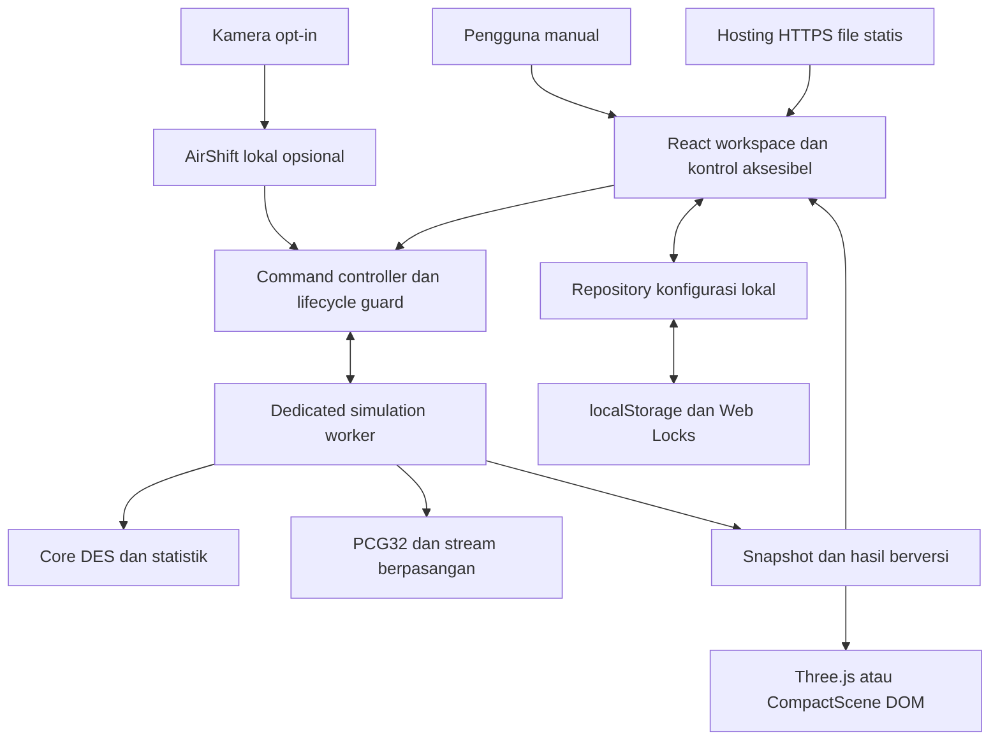
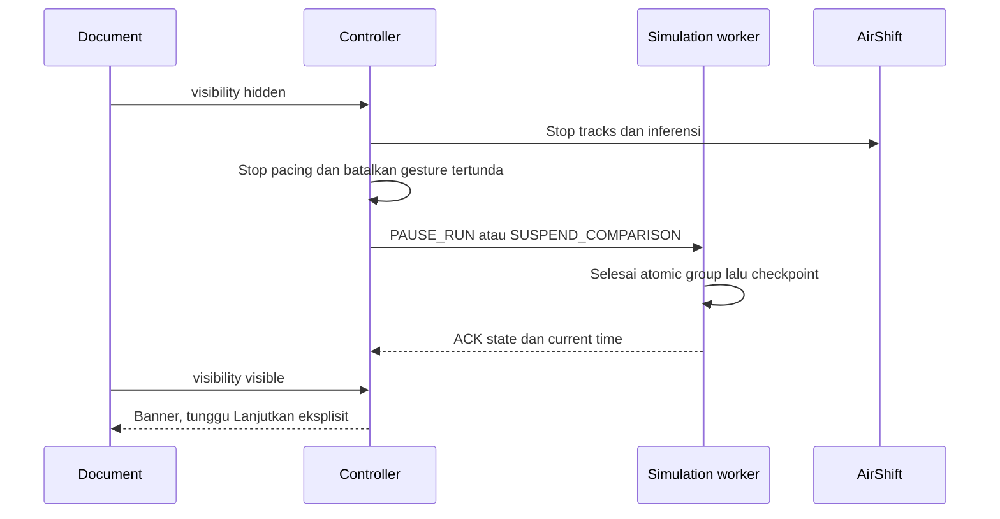

# TomorrowLab — Architecture

**Versi 1.0 · 26 Oktober 2026 · Bahasa Indonesia**

| Atribut | Ketentuan |
|---|---|
| Status | Baseline rancangan teknis untuk implementasi; belum ada aplikasi, dependency terpasang, deployment, atau benchmark yang diverifikasi |
| Basis kebutuhan | [PRD v1.0](/Users/adrian/Documents/Codex/2026-10-26/referenced-chatgpt-conversation-this-is-an/outputs/PRD.md) |
| Pendamping | [USER_FLOW.md](USER_FLOW.md), [DESIGN_SYSTEM.md](DESIGN_SYSTEM.md), [SIMULATION_SPEC.md](SIMULATION_SPEC.md) |
| Bentuk produk | SPA statis browser-only; satu workspace simulasi dan perbandingan |
| Stack baseline | React, TypeScript, Vite, Three.js; API browser untuk worker, kamera dan penyimpanan |
| Prinsip utama | Engine menentukan hasil; UI, renderer dan AirShift mengonsumsi state serta mengirim intent tervalidasi |

## 1. Tujuan dan batas rancangan

Arsitektur ini menerjemahkan kontrak produk menjadi batas modul, kepemilikan state, protokol pesan, lifecycle, penyimpanan dan strategi verifikasi. SIMULATION_SPEC menjadi sumber algoritme, distribusi, RNG, tie-break dan formula statistik. Dokumen ini menjelaskan penempatannya di aplikasi tanpa menduplikasi algoritme lengkap.

MVP tetap satu model kantin: FIFO bersama, 1–6 loket identik, kedatangan otomatis dan manual, run/pause/reset/replay, A/B 20 pasangan, serta konfigurasi lokal. Manual dapat menjalankan seluruh fitur inti. AirShift adalah adapter opsional, bukan dependensi engine.

Tidak membuat backend, database server, login, API publik, kolaborasi, pembayaran, PWA, sinkronisasi cloud, sistem plugin, atau penyimpanan progres lintas refresh. Tidak perlu desain horizontal scaling atau service discovery untuk produk lokal ini. Hosting menyajikan file aplikasi melalui HTTPS; seluruh komputasi model berjalan di browser.

### 1.1 Kondisi awal yang diamati

Workspace berisi USER_FLOW.md dan DESIGN_SYSTEM.md sebagai dokumen tahap sebelumnya; PRD berada di lokasi acuan di atas. Belum ada package manifest atau kode aplikasi yang menjadi pola implementasi. Karena itu stack dan struktur di dokumen ini adalah keputusan baseline baru, bukan hasil audit repository aplikasi yang sudah berjalan.

### 1.2 Otoritas dokumen

1. PRD menentukan scope, kontrak produk, statistik yang ditampilkan dan syarat rilis.
2. SIMULATION_SPEC menentukan semantik perhitungan serta format identitas/input yang diperlukan untuk determinisme.
3. USER_FLOW menentukan guard, keputusan pengguna, reset/replay, hidden dan fallback.
4. DESIGN_SYSTEM menentukan token, layout, komponen dan aksesibilitas.
5. ARCHITECTURE menentukan implementasi batas tanggung jawab untuk memenuhi semuanya.

Jika keputusan teknis mengubah fenomena simulasi atau definisi metrik, revisi PRD/modelVersion diperlukan. Mengganti cara deployment atau merapikan modul tidak otomatis mengubah modelVersion.

## 2. Keputusan teknis utama

| ID | Keputusan baseline | Alasan dan konsekuensi |
|---|---|---|
| ARC-DEC-01 | React + TypeScript + Vite sebagai SPA statis | Satu workspace dengan state eksplisit; build dapat di-host sebagai file statis. Tidak memakai SSR atau server aplikasi. |
| ARC-DEC-02 | Satu dedicated simulation Web Worker | Komputasi event dan batch terpisah dari UI; kontrol dapat ditangani pada yield. Worker bukan jaminan latency tanpa pengujian. |
| ARC-DEC-03 | Core DES murni TypeScript, tanpa DOM/React/Three.js | Modul yang sama dipakai runtime dan unit test; tidak ada dua implementasi model. |
| ARC-DEC-04 | Three.js pada main thread dengan scene adapter kecil | Renderer hanya proyeksi; maksimal 150 avatar; CompactScene DOM tetap tersedia. Tidak menambah wrapper rendering React pada baseline. |
| ARC-DEC-05 | React reducer untuk UI/draft; engine state dimiliki worker | Tidak menambah state library. Reducer harus murni; effect mengelola resource dan command lifecycle. |
| ARC-DEC-06 | PCG32-XSH-RR uint64/uint32, state BigInt internal | Kontrak deterministik dan stream terpisah; angka JSON tetap number/string yang tervalidasi. Detail dan vectors ada di SIMULATION_SPEC. |
| ARC-DEC-07 | Satu localStorage record per konfigurasi; mutasi diserialkan Web Locks | Maksimal 10 record, 100 KB per record; tidak membutuhkan indeks transaksi multi-key. Gagal storage tidak mematikan simulasi. |
| ARC-DEC-08 | AirShift lazy, inferensi lokal terpisah dari simulation worker | Tidak memblokir startup/model. MediaPipe Gesture Recognizer adalah kandidat baseline spike, bukan fitur yang sudah terbukti. |
| ARC-DEC-09 | Vitest untuk core/integrasi, Playwright untuk alur browser | Pengujian model dipisahkan dari animasi; tes E2E memeriksa tugas dan state. |
| ARC-DEC-10 | Lockfile dan versi runtime dikunci saat bootstrap | Dokumen tidak mengarang versi terbaru atau kompatibilitas yang belum diuji; perubahan package direview terhadap browser dan model. |

Dasar kemampuan platform: worker dan pertukaran pesan [A1], dukungan module worker/build Vite [A2], reducer React [A3], dan Three.js WebGLRenderer [A4]. Keputusan pembagian modul di sini merupakan rancangan proyek, bukan anjuran wajib dari dokumentasi tersebut.

### 2.1 Alternatif yang dipertimbangkan

| Keputusan | Alternatif | Trade-off |
|---|---|---|
| Worker engine | Engine seluruhnya di main thread | Kode awal lebih singkat, tetapi batch/RNG/scene dapat memblokir kontrol; tidak dipilih karena kebutuhan pause/cancel responsif. |
| Core event scan kecil | Heap/event framework generik | Maksimal enam departure aktif, next arrival, jadwal dan horizon cukup untuk scan kecil; framework menambah fleksibilitas yang belum dibutuhkan. |
| Reducer UI | Store eksternal/global state framework | Belum dibutuhkan untuk satu workspace; worker sudah memegang state model. |
| localStorage | IndexedDB | Data konfigurasi kecil dan write eksplisit; IndexedDB belum diperlukan. Revisit jika menyimpan hasil besar atau riwayat run. |
| Three.js langsung | React Three Fiber | Scene kecil dan satu adapter cukup; wrapper dapat dipertimbangkan jika tim sudah menggunakannya, dengan lifecycle dan kontrak yang sama. |
| Static client compute | Server simulation API | Menambah biaya, jaringan, privasi dan operasi deployment; tidak menyelesaikan kebutuhan MVP lebih baik. |

## 3. Gambaran sistem dan trust boundary



Tiga boundary wajib divalidasi: input UI/storage menuju config domain; command dari main menuju worker; serta hasil worker menuju UI. TypeScript mencegah banyak kesalahan saat build, tetapi tidak memvalidasi objek runtime. `postMessage` melakukan structured clone, bukan validasi data atau jaminan object tetap frozen.

Worker tidak mengakses localStorage atau DOM. Renderer tidak mengakses RNG engine. AirShift tidak memegang referensi engine dan hanya dapat menghasilkan intent pause/resume. Hosting tidak menerima frame kamera, konfigurasi atau hasil dari aplikasi MVP; log akses file statis penyedia hosting tetap mengikuti kebijakan penyedia.

## 4. Modul dan kepemilikan data

| Modul | Memiliki / melakukan | Tidak boleh |
|---|---|---|
| `app` | Workspace, dialog/drawer, reducer UI, draft, fokus, format angka | Menghitung event/service/mean secara mandiri |
| `controller` | Validasi command, active job, epoch/sequence, clock pacing, ACK, lifecycle | Menggunakan timer UI sebagai arrivalAt canonical |
| `domain` | Types, bounds, config/manual identity validation, version constants | Mengimpor React, renderer, browser storage |
| `simulation` | Queue, server/customer state, event scan, RNG, integrals, run result | Membaca waktu nyata, DOM, frame rate, camera pose |
| `comparison` | 20 pasangan serial, demand bersama, summary/CI, suspension | Menghapus pasangan kosong/gagal agar summary tampak valid |
| `workers` | Message adapter, cooperative scheduler, runtime ownership | Menjalankan loop CPU panjang tanpa yield |
| `scene` | Three.js, camera scene, interpolation, batas avatar, fallback | Menambah service time dari jarak berjalan/avatar |
| `storage` | Namespaced record, validation, lock, save/load/delete | Menghapus data rusak otomatis atau clear seluruh origin |
| `airshift` | Consent, camera lifecycle, local recognition, pose gate | Menambah pelanggan/reset/save atau mem-bypass command guard |

### 4.1 Tiga bentuk state

- **Draft UI:** boleh invalid sementara saat diketik. Baru menjadi ScenarioConfig setelah validasi. Tidak pernah langsung dibaca run aktif.
- **Canonical engine state:** hanya worker yang memutasi. Snapshot parameter immutable secara kontrak; core boleh memutasi working arrays internal untuk efisiensi. Input live masuk lewat command yang diakui.
- **View projection:** salinan untuk UI/scene dengan runId, simTime, revision dan validity. Tidak cukup untuk memulihkan worker yang mati. Hasil final selalu menyertakan snapshot asal dan versi.

State run tetap READY/RUNNING/PAUSED/COMPLETED/ERROR/LIMIT_REACHED/CANCELLED. Phase arrivalsOpen/draining terpisah. `pendingPause`, `saving`, `staleResult` dan `comparisonSuspended` adalah state UI/operasi, bukan model state tambahan.

### 4.2 Struktur sumber yang disarankan

```text
src/
  app/                 workspace, komponen, reducer, format angka
  controller/          command client, pacing, lifecycle
  domain/              config/types, bounds, validators, versions
  simulation/          core, rng, metrics, fixtures test
  comparison/          runner dan summary berpasangan
  workers/             simulation.worker.ts dan protocol.ts
  scene/               renderer adapter dan CompactScene
  storage/             repository konfigurasi
  airshift/            adapter opsional, pose gate, worker inferensi
  styles/              tokens dan CSS komponen
tests/
  integration/         protokol, lifecycle, storage
  e2e/                 tugas manual, fallback, aksesibilitas
public/
  models/              hanya bila AirShift disertakan
```

Ini struktur awal, bukan kewajiban satu file per konsep. Gabungkan file kecil yang memang dikerjakan bersama. Tidak membuat container/service/interface abstrak untuk implementasi tunggal tanpa alasan.

## 5. Kontrak data dan versioning

### 5.1 Identitas versi

| Field | Nilai baseline | Perubahan yang menaikkan versi |
|---|---|---|
| schemaVersion | `1` | Bentuk konfigurasi tersimpan |
| modelVersion | `canteen-fifo-v1` | Fenomena, tie-break, horizon, distribusi atau definisi metrik |
| engineVersion | `des-ts-v1` | Perilaku implementasi engine yang memengaruhi replay/hasil |
| rngVersion | `pcg32-xsh-rr-v1` | Algoritme/output transform RNG |
| seedDerivationVersion | `seed-pcg32-v1` | Pemetaan root seed, replication index, domain stream, customer ordinal |
| protocolVersion | `1` | Bentuk dan semantik pesan worker |

Nomor dokumen v1.0 tidak berarti semua field di atas berubah bersamaan. Hasil versi berbeda tidak digabung ke satu batch. Record schema/model yang belum didukung ditampilkan sebagai tidak dapat dimuat, dipertahankan sampai pengguna memilih hapus. Tidak ada migrasi diam-diam pada MVP.

### 5.2 DTO inti

```ts
type ManualEntry = {
  id: string;
  atSimSec: number;
  count: number;
  sequence: number;
  customerOrdinals: number[];
};

type ScenarioConfig = {
  id: string;
  name: string;
  schemaVersion: 1;
  modelVersion: "canteen-fifo-v1";
  c: number;
  lambdaPerMinute: number;
  serviceMinSec: number;
  serviceMaxSec: number;
  horizonSec: number;
  rootSeed: number;
  manualSchedule: ManualEntry[];
};
```

Ini sketsa kontrak, bukan kode aplikasi yang telah dibuat. Validator memastikan integer/range, waktu finite, count sama dengan panjang ordinal, ID/sequence unik, serta ordinal manual unik dalam gabungan schedule+log. Ordinal berada 0–1999; ID pelanggan otomatis `a:<index>`, manual `m:<ordinal>`. Field ordinals adalah pelengkap teknis domain PRD untuk menjaga service variate saat simpan/replay/A/B.

`manualSchedule` memuat jadwal dasar. `inputLog` hanya tambahan live yang diterima, termasuk yang masih menunggu pada PAUSED. Merge untuk simpan/A/B menghasilkan satu schedule dengan identitas tetap, log run baru kosong. Jangan mengubah customer ID menjadi ID loket atau ordinal urutan mulai layanan.

### 5.3 Snapshot dan fingerprint

RunResult memuat counts, horizon/cohort metrics, input log, configSnapshot, seed/replication index, validity, stopReason dan seluruh versi engine/RNG. Timestamp kalender, nama, runId dan revision transport tidak ikut menentukan hasil numerik.

Untuk mendeteksi hasil stale, buat canonical configuration signature dari field yang memengaruhi model: parameter, seed, versi dan schedule dengan urutan stabil. Bandingkan struktur/canonical string; hash kriptografis tidak wajib. Nama/id konfigurasi dan camera scene tidak memengaruhi signature numerik. Snapshot input disalin dan divalidasi pada boundary; `Object.freeze` development boleh membantu, tetapi bukan mekanisme keamanan.

## 6. Protokol controller–worker

### 6.1 Envelope

```ts
type CommandEnvelope<T> = {
  protocolVersion: 1;
  epoch: number;
  jobId: string;
  commandSeq: number;
  payload: T;
};

type ReplyEnvelope<T> = {
  protocolVersion: 1;
  epoch: number;
  jobId: string;
  replyTo: number | null;
  snapshotRevision: number;
  payload: T;
};
```

`epoch` adalah generasi runtime worker. Naikkan pada reset/replacement run atau recreation worker setelah seluruh pekerjaan sebelumnya dihentikan. `jobId` membedakan visual run dan satu batch. Memulai batch tidak mengganti epoch visual run yang sedang PAUSED; worker dapat menyimpan konteks visual tersebut. Pesan batch yang sudah dibatalkan diabaikan berdasarkan jobId/status, meski epoch masih sama.

`commandSeq` adalah integer monoton dalam satu epoch. Command yang sudah diterima tidak dieksekusi ulang. ACK/reply mutasi disimpan terbatas untuk 64 command terakhir; duplicate lebih lama ditolak sebagai duplicate, bukan diterapkan lagi. Tidak menyimpan semua ADVANCE_TO/frame sepanjang sesi. `snapshotRevision` monoton per job untuk mengabaikan proyeksi lama. ACK kontrol tidak ditunda oleh throttle snapshot.

**Handshake generasi:** worker yang baru dibuat belum terikat epoch dan hanya menerima CREATE_RUN pertama dengan protocolVersion yang cocok; main memilih epoch berikut dari counter sesi. Setelah terikat, command normal wajib memakai epoch aktif. RESET_RUN/REPLAY_RUN/replacement dikirim dengan envelope epoch aktif dan payload `nextEpoch=epoch+1` serta `nextRunId`. Worker menyelesaikan checkpoint, menghapus konteks lama, lalu menyiapkan generasi baru secara atomik. ACK transisi memakai envelope epoch lama dan replyTo command asal, dengan payload nextEpoch/nextRunId; ACK ini dikirim sebelum snapshot generasi baru. Main menahan command baru dan mengabaikan proyeksi lama selama transisi, kemudian mengesahkan epoch baru hanya sesudah ACK yang cocok. CommandSeq generasi baru mulai1, snapshotRevision mulai0. Tidak menaikkan epoch main lebih awal lalu membuang ACK reset sendiri. Kegagalan handshake menjadi error/reset ulang eksplisit, bukan retry mutasi otomatis.

Tidak melakukan auto-retry mutasi ketika status tidak pasti. Normal postMessage yang sudah diterima diproses serial; error worker ditangani sebagai kegagalan, bukan ditebak dengan mengirim ulang Tambah pelanggan.

### 6.2 Command dan guard

| Command | Payload penting | Guard dan respons |
|---|---|---|
| CREATE_RUN | Config valid, replay log opsional | Hanya bila tidak ada job aktif; validasi ulang, inisialisasi READY lalu start melalui RUN |
| RUN | runId | READY → RUNNING; snapshot dikunci |
| ADVANCE_TO | targetSimSec | RUNNING visual; target≥current; maksimal satu request advance in-flight |
| PAUSE_RUN | reason manual/gesture/hidden | Interrupt advance pada checkpoint; ACK membawa current SimTime dan PAUSED |
| RESUME_RUN | source manual/gesture | PAUSED; gesture ditolak bila alasan hidden; anchor pacing baru |
| ADD_MANUAL | count; tanpa timestamp UI | RUNNING/PAUSED, t<H, bukan fast/batch; worker memberi timestamp, sequence dan ordinal |
| FAST_FINISH | runId | RUNNING/PAUSED; jalankan core sampai drain, tidak menerima input tambahan baru |
| CANCEL_FAST | runId | Fast aktif; stop pada checkpoint → CANCELLED nonfinal |
| RESET_RUN | target runId, nextEpoch, nextRunId | Setelah konfirmasi dan tanpa batch aktif; hentikan pekerjaan run, bersihkan runtime/log live, pertahankan parameter/base schedule; handshake §6.1 |
| REPLAY_RUN | Snapshot asal + log live, nextEpoch, nextRunId | COMPLETED dan tanpa batch; handshake §6.1, generasi baru memakai input sama sekali masing-masing |
| START_COMPARISON | A, B, demand sama, root seed | Tidak ada komputasi lain: visual READY/tanpa runtime, PAUSED atau terminal; tepat 20 pasangan; draft dikunci |
| SUSPEND_COMPARISON | reason hidden | Checkpoint current subrun tetap di memori; summary nonfinal |
| RESUME_COMPARISON | batchId, source manual | Hanya suspended; tidak catch-up waktu nyata |
| CANCEL_COMPARISON | batchId | Stop batch; pertahankan summary lengkap sebelumnya dan visual run PAUSED |

Nama command adalah kontrak baseline untuk implementasi, bukan API internet. Kamera scene, speed UI, dialog dan fokus tidak memerlukan command engine kecuali menghasilkan intent run yang sah. Semua mutasi menargetkan run/job yang tepat dan divalidasi lagi saat diterima, bukan hanya saat tombol di-enable.

### 6.3 ACK dan snapshot

Reply jenis ACK berisi accepted/rejected, code, canonical state/SimTime serta data tindakan: misalnya `ADD_MANUAL` mengembalikan entry yang sudah ditetapkan worker. UI boleh menampilkan “Menambahkan…” selama menunggu, tetapi count canonical belum bertambah sebelum event diproses.

Jika ordinal manual tersisa tidak cukup untuk seluruh count, jangan menerima entry parsial: hentikan run sebagai LIMIT_REACHED dengan pesan batas input, dan simpan percobaan yang ditolak hanya sebagai diagnostik. Jika entry sudah sah diterima lalu gabungan arrival otomatis+manual mencoba melampaui 2.000 saat diproses, core mempertahankan prefix pelanggan yang sudah diterima dan menutup transaksi sesuai SIMULATION_SPEC §4.5, lalu berhenti invalid. UI membedakan jumlah yang dicatat, tiba dan belum diproses; tidak menampilkan seluruh batch sebagai sukses tiba. Pending input yang sah tidak dijalankan dua kali saat resume.

Snapshot visual dibatasi paling sering 10 Hz dan selalu pada state canonical yang selesai diproses. Muat counts penuh, server state, phase, metric sementara dan subset representasi avatar≤150; log input dikirim saat berubah. Record pelanggan lengkap≤2.000 tetap di worker dan tersedia pada hasil/detail yang diperlukan. Renderer rAF dapat menginterpolasi tampilan, tetapi tidak memajukan model. Terminal reply dan ACK dikirim segera, tidak menunggu jadwal snapshot.

### 6.4 Penanganan stale dan race

| Race | Kebijakan |
|---|---|
| Reset saat snapshot lama sedang dikirim | Epoch lama diabaikan; tidak menghidupkan kembali run lama |
| Tambah saat pause menunggu ACK | Urutan command serial menentukan penerimaan; UI menampilkan pending, tidak mengarang arrivalAt |
| Fast selesai sebelum cancel diterima | COMPLETED menang; cancel ditolak no-op dengan state terminal, tanpa pesan batal palsu |
| Cancel diterima sebelum selesai | CANCELLED nonfinal; tidak menerbitkan RESULT_COMPLETE sesudahnya |
| Tab hidden saat modal terbuka | Lifecycle tetap dijalankan; stop kamera dan pause/suspend tidak menunggu dialog |
| H tercapai saat klik pelanggan sedang dikirim | Worker revalidasi t<H; reject tanpa entry/log sukses bila sudah ditutup |
| Pindah Simulasi saat batch berjalan | Tampilan boleh berubah; run lain tidak boleh resume hingga batch selesai/batal |
| Snapshot revision terlambat | Jangan mengganti proyeksi yang revision-nya lebih baru |

## 7. Waktu, scheduling dan lifecycle

### 7.1 Pacing visual

Main controller menggunakan `performance.now()` hanya untuk menentukan target pacing. Rumus target dasar: anchorSim + elapsedRealSeconds×speed. Anchor dimulai dari canonical SimTime pada ACK run/resume/speed change. Setiap request dibatasi maksimal lastAcknowledgedSimTime+1 detik agar tidak menumpuk look-ahead besar. Maksimal satu ADVANCE_TO yang belum selesai; rAF tidak membuat antrian command per frame.

ADVANCE_TO memproses seluruh event≤target dan mengintegrasikan interval kosong sampai target. Artinya pause pada t=10 sah walau tidak ada event tepat t=10. Renderer tidak menganggap last departure time sebagai current model time. Saat mencapai completion, engine berhenti di T_end, tidak memajukan hasil sesudahnya.

Ketika control command datang, hentikan penerbitan target baru. Worker menginterupsi advance lama pada checkpoint, mengakui current time, lalu menerapkan control. ADD_MANUAL memakai current time pada penerimaan ini. Setelah ACK, controller membangun anchor baru sehingga target lama yang belum dicapai tidak dijalankan diam-diam sebelum input live. Sisa ADVANCE_TO yang terinterupsi dianggap selesai dengan reason interrupted.

Kecepatan 1×/5×/20× hanya pacing, bukan pengali service time atau interval RNG. Perbandingan tidak dipacing oleh waktu nyata. Golden/replay tests memberi target dan input log yang sama agar perbedaan kecepatan klik nyata pengguna tidak disalahartikan sebagai nondeterminisme.

### 7.2 Cooperative yield

Core memproses satu timestamp sebagai unit atomik. Adapter worker mengecek budget setelah setiap unit: yield setelah sekitar 4 ms kerja atau 100 kelompok timestamp, mana tercapai lebih dulu. Gunakan macrotask yield, misalnya penjadwalan task berikut, agar event message PAUSE/CANCEL dapat ditangani; rangkaian microtask saja tidak cukup. API step/checkpoint core tidak membaca jam nyata; keputusan budget dan penjadwalan task berada pada adapter. Unit test dapat memanggil step yang sama sampai target tanpa scheduler browser.

Jangan memecah satu timestamp di tengah departure/arrival/dispatch. Unit terburuk tetap dibatasi 2.000 pelanggan dan 6 loket; benchmark unit ini wajib. Budget 4 ms adalah target desain, bukan bukti semua perangkat mencapainya. Target produk tetap pause ≤100 ms dan cancel ≤500 ms pada perangkat acuan. Jika satu atomic group melanggar target, optimalkan loop/struktur yang sama sebelum menambah kerumitan scheduler.

### 7.3 Hidden, unmount dan resource



Saat hidden, hentikan media tracks di main thread segera, buang frame/pose tertunda dan stop clock pacing. Worker pause RUNNING, fast kembali PAUSED dengan fast mode off, batch ditangguhkan. READY/COMPLETED/terminal tidak diubah menjadi PAUSED palsu. UI menampilkan “Menjeda…” sampai ACK; canonical PAUSED baru dinyatakan setelah worker berhenti.

Tidak menghitung elapsed waktu hidden saat kembali. Kamera selalu perlu opt-in lagi. Jika browser membekukan/menutup proses sehingga checkpoint hilang, tampilkan kegagalan sesi saat diketahui; mirror UI bukan dasar resume. Refresh memuat konfigurasi tersimpan saja. `beforeunload` hanya perlindungan tambahan bila platform mengizinkan, bukan jaminan progres aman.

Unmount membersihkan event listener, rAF, timer, worker, observer, media track serta resource Three.js yang dimiliki scene. Effect harus idempotent agar mount/unmount development tidak menggandakan worker atau command RUN. Reducer React tidak menjalankan efek samping [A3].

## 8. Core simulasi dan comparison runner

Core menyimpan queue FIFO memakai array+head index, server slots maksimal 6, customer records ≤2.000, pointer next arrival otomatis, jadwal manual terurut dan horizon marker. Pemilihan waktu kejadian memakai scan kecil. Tidak perlu priority queue generik atau pathfinding.

API konseptual: buat state tervalidasi, advanceTo(target), enqueueManual(count), ambil snapshot, serta jalankan satu kelompok timestamp. Finish memakai API yang sama dalam loop terjadwal. Formula, identity allocator, RNG dan invariant dijelaskan di SIMULATION_SPEC; adapter tidak menghitung metrik versi lain.

Batch berjalan serial: r=0 sampai 19; untuk setiap r siapkan demand/service variates bersama dan jalankan A lalu B memakai input sama. Satu visual run PAUSED boleh ditahan di slot terpisah, tetapi tidak dihitung bersamaan. Batalkan/suspend pada checkpoint, termasuk di tengah subrun; pasangan baru diakui selesai setelah kedua sisi valid. Maksimal dua result per pasangan dan summary yang diperlukan disimpan, bukan 40 event trace penuh.

Ringkasan final hanya setelah 20 pasangan valid. Bila ada N=0, cohort inferential summary/CI N/A sesuai PRD, count tetap ditinjau. Error/limit satu sisi membatalkan validity keseluruhan. Tidak menghapus pasangan kosong/gagal atau mengganti seed untuk mendapatkan output yang lebih menarik.

Identitas hasil batch mencakup snapshot A/B, seedDerivationVersion, daftar replication index 0–19, demand/manual signature, engine/RNG version dan metode summary. Nama scenario atau label A/B tidak menentukan stream. Penambahan loket tidak menggeser service variate karena variate terikat customer ID.

## 9. Renderer dan aksesibilitas

Three.js WebGLRenderer baseline menggunakan WebGL2; dokumentasi saat penyusunan menyatakan WebGL1 tidak didukung [A4]. Capability check dan pembuatan renderer harus mempunyai failure path. Produk tetap memenuhi jalur manual melalui CompactScene jika grafis tidak tersedia; tidak menjanjikan 3D pada perangkat yang hanya memiliki WebGL1.

Scene adapter menerima projection, membuat geometri loket/avatar sederhana dan mengelola kamera ortografis. CameraControls DOM menyediakan pan/rotate/zoom/reset. Tidak ada collider, physics engine, jarak tempuh model, navigasi NPC atau waktu menunggu animasi sebelum departure. Objek visual dipool/reuse seperlunya dengan batas150; angka canonical tidak diambil dari jumlah mesh.

`webglcontextlost`, exception renderer, atau mounting gagal mengubah display mode saja. UI dan simulation worker tetap hidup; coba 3D lagi merupakan aksi eksplisit. Dispose geometry/material/renderer saat diganti; ukuran canvas mengikuti container dan DPR dibatasi awal ≤1,5 sebagai budget desain yang boleh disesuaikan setelah benchmark.

React merender kontrol/label/list/tabel semantik dengan design tokens. Tidak memakai canvas sebagai tombol satu-satunya atau role application pada seluruh halaman. Dialog, tabs, keyboard serta reduced motion mengikuti USER_FLOW/DESIGN_SYSTEM; tidak ditentukan ulang oleh renderer.

## 10. Penyimpanan konfigurasi dan integritas write

### 10.1 Bentuk record

Satu key `tomorrowlab:scenario:<recordId>` memuat satu JSON record: schemaVersion, recordId, revision, savedAt, config dan model/seed version yang diperlukan. Nama/id tetap teks. Ukuran dihitung atas byte UTF-8 JSON final dan harus≤100 KB, selain batas jumlah pelanggan/schedule. Total key namespace maksimal10, termasuk record malformed/unsupported yang dipertahankan.

Tidak ada key indeks yang harus diperbarui bersamaan. Daftar diperoleh dengan enumerasi namespace milik aplikasi, kemudian validasi tiap record. Tidak memakai `localStorage.clear()`. Record yang rusak ditampilkan dengan status tidak dapat dimuat; aplikasi tidak menerka sebagian parameter.

### 10.2 Mutasi aman

1. Saat membuka konfirmasi overwrite/delete, simpan recordId, expected raw value dan revision yang dilihat pengguna.
2. Bentuk payload baru dan validasi penuh sebelum mutasi. Operasi baru memakai ID acak melalui API browser, bukan seed model.
3. Ambil exclusive Web Lock bernama `tomorrowlab:scenario-write:v1` [A6]. Semua operasi save/delete milik app menggunakan lock ini.
4. Di dalam lock, baca ulang record/namespace dan bandingkan target dengan expected value. Konflik berarti dialog perlu dimuat ulang dan pengguna memilih kembali; jangan diam-diam menimpa versi tab lain.
5. Untuk slot baru, periksa jumlah<10. Untuk overwrite, pastikan target tepat. Lakukan satu `setItem` tanpa remove-before-set; delete melakukan satu `removeItem` setelah guard.
6. Jika write melempar exception, tampilkan belum tersimpan dan pertahankan draft; jangan hapus record lama sebagai upaya mengosongkan ruang.
7. Jika write selesai lalu readback gagal/tidak cocok, tampilkan “Status penyimpanan belum dapat dipastikan” dan segarkan daftar secara eksplisit. Tidak menjanjikan rollback otomatis atau mengulang write tanpa konfirmasi.

localStorage bukan transaksi multi-key atau backup; dapat diblokir/dibersihkan browser [A5]. Web Locks menyerialkan tab aplikasi yang bekerja sama; tidak melindungi dari devtools atau script lain yang mengabaikan lock. `storage` event menandai daftar/dialog stale, tetapi bukan pengganti lock atau compare-and-swap.

Jika storage/Web Locks tidak tersedia atau izin ditolak, disable write dengan sebab jelas; run tetap berfungsi di memori dan record yang masih dapat dibaca tetap dapat ditinjau. Ini graceful degradation FR-23, bukan bukti bahwa gate save/load FR-21–22 lulus. Browser wajib harus diuji menyimpan/memuat sukses di lingkungan QA yang mendukung.

Hapus seluruh data TomorrowLab, jika disertakan, memakai lock yang sama dan konfirmasi terpisah. Karena penghapusan banyak key tidak atomik, laporkan jumlah sukses/gagal dan pertahankan sisanya; jangan menyatakan semua terhapus bila baru sebagian.

## 11. AirShift dan boundary privasi

### 11.1 Adapter opsional

Build default tetap menjalankan manual tanpa model gesture. Feature flag build menentukan apakah entry point AirShift tersedia; flag bukan preferensi yang otomatis menyalakan kamera. Setelah opt-in, lazy import adapter, muat model/WASM dari origin yang dikendalikan, lalu minta video tanpa audio. Tidak menambahkan CDN remote inference.

Kandidat baseline spike adalah MediaPipe Gesture Recognizer untuk pose Open_Palm dan Thumb_Up. Dokumentasi Google menyebut metode pengenalan berjalan sinkron dan dapat memblokir UI, sehingga baseline menempatkan inferensi pada worker terpisah jika integrasi ini disertakan [A7]. Tidak menaruh inferensi pada simulation worker.

Main mengirim maksimal satu frame in-flight pada cadence awal 10 FPS; frame berikutnya di-drop bila worker belum selesai. Frame/bitmap dilepas setelah dipakai; tidak menumpuk buffer. Hasil hanya memuat pose, confidence, hand count dan timestamp nyata untuk pose gate. Tidak menyimpan frame/landmark di storage atau diagnostik. Jika worker/model/browser tidak cocok atau latency gate gagal, keluarkan AirShift dari submission.

### 11.2 Guard aksi

Pose gate main memeriksa state terbaru, modal/fokus, status batch/fast, frame stale, confidence/dwell, re-arm dan cooldown. Ia hanya mengirim intent pause atau resume; controller dan worker tetap memvalidasi guard. Kamera putus menghentikan adapter, bukan reset model. Pause hidden tidak dapat di-resume gesture.

`getUserMedia` dipanggil setelah penjelasan dan tindakan pengguna; video harus pada secure context [A8]. Matikan kamera menghentikan seluruh tracks, loop capture dan worker inferensi. Tangani permission promise yang selesai terlambat: bila request generation sudah dibatalkan/hidden, stop tracks yang baru diterima dan jangan mengaktifkan kamera lagi. Ini juga berlaku pada lazy import/model load yang selesai setelah panel dibatalkan.

Tidak ada janji secure memory erase pada runtime browser; aplikasi melepas referensi/buffer yang dikuasainya dan tidak merekam data. Teks produk tetap menyatakan pemrosesan lokal tanpa pengiriman/penyimpanan frame. Audit network harus membedakan download model sah dari upload data kamera yang dilarang.

## 12. Build, hosting dan keamanan aplikasi

Build menghasilkan satu direktori statis berisi HTML, CSS, JS chunks, simulation worker dan aset sah. Vite mendukung pola module worker melalui konstruktor Worker+URL dan build statis [A2]. Exact package versions, package manager tunggal dan versi Node yang memenuhi seluruh toolchain dicatat saat bootstrap, kemudian dikunci lockfile dan CI. Jangan memakai tag latest sebagai kontrak build reproducible.

CI minimum: install dari lockfile → typecheck TypeScript → unit/integration tests → build → E2E smoke terhadap build produksi. Vite melakukan transpilation, bukan typecheck penuh, sehingga typecheck harus langkah tersendiri [A2]. Vitest dan Playwright adalah pilihan baseline; versi yang dipin harus diuji bersama toolchain [A10–A11].

Hosting harus HTTPS, dapat mengirim MIME JS/worker/WASM dengan benar, tanpa login, dan menjaga tautan penjurian. Tidak ada secret di environment client; nilai build-time yang masuk bundle dianggap publik. Satu workspace tidak membutuhkan router URL kompleks; base path asset ditetapkan sesuai host dan diuji dari URL produksi, bukan hanya dev server.

| Area | Baseline keamanan / deployment |
|---|---|
| Input | Validator runtime di UI/storage/worker; safe bounds dan ukuran sebelum alokasi besar |
| Rendering teks | Nama dan error sebagai teks; tidak memakai raw HTML atau eval dari konfigurasi |
| Resource | Script/style/worker/model berasal dari origin yang dikendalikan; batasi external connections |
| CSP | Tetapkan berdasarkan bundle nyata; script/worker same-origin, object none, base-uri terbatas; uji dynamic import/worker/model |
| WASM | Jika AirShift memerlukan izin CSP khusus, batasi seperlunya dan verifikasi; jangan menyalin unsafe-eval tanpa bukti kebutuhan |
| Permissions | Kamera hanya origin sendiri; microphone tidak diminta; framing dibatasi sesuai host yang dipilih |
| Cache | HTML revalidate; hashed assets immutable; deployment atomik agar HTML/worker tidak campur build |
| Offline | Bekerja dengan resource yang sudah dimuat bila tersedia; tidak menjanjikan cold-start offline atau install PWA |
| Source/dependencies | Pin versi, review lisensi dan advisories sebelum rilis; disclosure sesuai aturan lomba pada materi submission |

Tidak mewajibkan SharedArrayBuffer, COOP/COEP, OffscreenCanvas atau WebGPU untuk MVP. Jika dependency opsional ternyata membutuhkan perubahan itu, evaluasi melalui spike; jangan mengorbankan jalur manual demi AirShift.

Rollback deployment memakai artefak build sebelumnya dengan URL utama sama dan versi jelas. Konfigurasi schema baru yang tidak dapat dibaca build lama tetap dipertahankan sebagai unsupported; rollback tidak menghapus data browser untuk menyembunyikan ketidakcocokan.

## 13. Failure isolation dan observabilitas

| Kegagalan | Respons arsitektur | Yang dipertahankan |
|---|---|---|
| Renderer/WebGL2 | Unmount scene, CompactScene aktif | Engine, input log, metrik dan kontrol |
| Storage/lock | Read/memory mode dengan pesan write gagal | Draft/run; record lama tidak dihapus |
| Gesture/model/camera | Stop adapter dan tracks; status off/error | Manual controls dan run state |
| Core invariant/limit | Stop job dengan invalid/nonfinal | Snapshot parameter, accepted log, state parsial yang aman |
| Worker error/messageerror | Stop pacing, tandai pekerjaan gagal, hentikan active job; tawarkan reset | Draft, summary lengkap sebelumnya di main, data tersimpan |
| Protocol mismatch | Tolak komunikasi, jangan interpretasi payload parsial | Konfigurasi; sarankan reload konsisten |
| Asset gagal | Area terkait gagal dengan pesan; jangan crash seluruh workspace | Fungsi yang resource-nya sudah tersedia |

Bila worker gagal saat batch, status batch gagal dan visual context di worker juga tidak dianggap dapat dilanjutkan. Tidak mencoba resume dari proyeksi UI. Worker baru hanya dimulai melalui reset/new run, dengan epoch baru dan data tervalidasi.

Diagnostik lokal berisi build/model/RNG version, browser/perangkat saat QA, jobId, seed, config signature, kode error serta ring buffer64 command metadata. Jangan memasukkan video, landmark, nama orang, secret atau raw file perangkat. Accepted inputLog tetap tersimpan lengkap di memori sesuai batas run untuk replay; berbeda dari ring buffer diagnostik. Full canonical event trace disediakan pada test harness/debug saja, bukan terus dikirim ke React.

Tidak ada telemetry/session replay pihak ketiga pada MVP. UI dapat menawarkan salin rincian non-sensitif ketika error; tindakan pengguna eksplisit diperlukan untuk membagikannya. Waktu kalender diagnostik tidak masuk RNG atau formula simulasi.

## 14. Budget, skala dan pengujian

### 14.1 Skala desain

| Dimensi | Batas / target |
|---|---|
| Pelanggan canonical | ≤2.000 per replikasi |
| Loket | 1–6 |
| Avatar | ≤150; agregat tetap berlabel |
| Comparison | 20 pasangan, serial, satu batch aktif |
| Visual runtime | Maksimal satu run visual tertahan ketika batch; tidak diproses bersamaan |
| Konfigurasi | Maksimal10 record×100 KB; quota sebenarnya dapat lebih rendah dan ditangani |
| Worker simulasi | Tepat satu saat workspace aktif; worker inferensi hanya opsional |
| Pacing transport | Maksimal satu advance in-flight; proyeksi visual≤10 Hz |
| Kontrol | Feedback≤100 ms, pause≤100 ms, cancel≤500 ms pada perangkat acuan |
| Performa | Default batch≤10 detik, fast finish≤2 detik; scene median≥30 FPS sesuai PRD |

Angka ini budget, belum benchmark. PCG BigInt, serialization, atomic batch arrivals2.000 dan inferensi perlu diukur pada laptop acuan. Jika lambat, mulai dari pemangkasan visual dan payload, optimasi loop yang terbukti bottleneck, dan menonaktifkan AirShift; tidak mengubah distribusi, count atau formula untuk mengejar FPS.

### 14.2 Pengujian per boundary

| ID | Pengujian minimum | Bukti penerimaan |
|---|---|---|
| ARC-QA-01 | Pure core dan RNG | Semua SIMULATION_SPEC fixtures/golden vectors/invariant lulus tanpa DOM |
| ARC-QA-02 | Worker parity | Fixture yang sama melalui worker dan direct core menghasilkan hasil sama dalam toleransi |
| ARC-QA-03 | Race command | Reset/stale epoch, duplicate ADD, manual saat pause, late arrivalH, cancel-vs-complete memberi satu hasil konsisten |
| ARC-QA-04 | Pause dan yield | Pause/hidden memotong long advance/fast, bukan menunggu seluruh run; ACK memenuhi budget |
| ARC-QA-05 | Batch | Tepat20 pasangan; snapshot terkunci; N=0/gagal/cancel/suspended tidak menjadi summary inferensial final |
| ARC-QA-06 | Storage | Save/load/delete; full slots; quota/lock denied; malformed schema; cross-tab konflik; write/readback failure |
| ARC-QA-07 | Fault isolation | Hilang WebGL tidak menghentikan model; gagal worker tidak dipulihkan dari mirror; gagal kamera tidak mereset run |
| ARC-QA-08 | Resource cleanup | Dua puluh siklus run/reset/mount/unmount tidak meninggalkan worker/track/listener ganda |
| ARC-QA-09 | UI dan aksesibilitas | Kamera off, keyboard-only, viewport/zoom, screen reader, reduced motion dan CompactScene menyelesaikan semua Must |
| ARC-QA-10 | Privacy | Kamera hanya setelah opt-in; request terlambat/hidden langsung berhenti; inspeksi network tidak ada upload frame |
| ARC-QA-11 | Build produksi | Typecheck/test/build; worker path, CSP, MIME, lazy chunks dan model diuji pada host HTTPS sesungguhnya |
| ARC-QA-12 | Reproducibility build/hasil | Artefak build tercatat; seed/versi/log sama mereplay; rendering/speed tidak mengubah hasil |

Browser test otomatis memakai engine yang didukung runner; hasilnya tidak menggantikan pemeriksaan browser Chrome/Edge/Firefox aktual yang diwajibkan PRD. Safari tetap diuji bila perangkat tersedia. Tidak mengklaim semua browser lolos karena satu tes Chromium lulus.

## 15. Traceability, status keputusan dan pengembangan berikutnya

| Area | Requirements utama |
|---|---|
| Workspace/reducer/draft | FR-01–04,09,25,28; NFR-06–09 |
| Controller/core/time | FR-05–10,13,15,26–29,34; NFR-01–04,14 |
| Renderer/fallback | FR-11–12,24,33 jika dibuat; NFR-03,07,10 |
| Comparison | FR-16–20; NFR-01,04 |
| Storage | FR-21–23; NFR-12–13 |
| AirShift | FR-30–32 opsional; NFR-11 |
| Hosting/security | NFR-05,12,15 |

**Dikunci pada baseline dokumen:** browser-only, core murni, satu simulation worker, command/ACK+epoch, manual timestamp di worker, PCG32 dan stream identity, single active job, namespace storage dengan write lock, renderer serta gesture terisolasi.

**Diselesaikan saat bootstrap:** exact package/Node versions, host HTTPS, build settings CSP/MIME/base path, actual reference machine, package icon dan lisensi. Tidak menahan penulisan core/spec test, tetapi harus selesai sebelum release candidate.

**Hanya melalui spike opsional:** versi model MediaPipe, kemampuan worker inferensi, latency/camera privacy gate dan kebutuhan WASM policy. Bila gagal, AirShift tidak dirilis. Tidak ada open question yang mengizinkan manual controls dikurangi.

**Pascalomba:** persistence hasil besar dapat memakai IndexedDB; skenario multi-domain mungkin memerlukan model registry; sharing/cloud memerlukan auth dan kebijakan data; parallel replication perlu kajian resource. Tidak membangun abstraksi tersebut sekarang.

## 16. Referensi

Sumber resmi berikut diperiksa 26 Oktober 2026; exact versions yang dipasang belum ditentukan atau diuji. Rekomendasi arsitektur adalah keputusan proyek berdasarkan kontrak kebutuhan.

- **[A1]** [MDN — Using Web Workers](https://developer.mozilla.org/en-US/docs/Web/API/Web_Workers_API/Using_web_workers): worker context dan messaging.
- **[A2]** [Vite — Features](https://vite.dev/guide/features.html), [Static Deploy](https://vite.dev/guide/static-deploy.html): module worker, transpilation dan build statis.
- **[A3]** [React — useReducer](https://react.dev/reference/react/useReducer): reducer dan kemurnian state transition.
- **[A4]** [Three.js — WebGLRenderer](https://threejs.org/docs/pages/WebGLRenderer.html): renderer WebGL2 dan batas WebGL1.
- **[A5]** [MDN — localStorage](https://developer.mozilla.org/en-US/docs/Web/API/Window/localStorage): penyimpanan origin dan potensi pembatasan browser.
- **[A6]** [MDN — Web Locks API](https://developer.mozilla.org/en-US/docs/Web/API/Web_Locks_API): koordinasi resource antar-tab aplikasi.
- **[A7]** [Google — Gesture Recognizer for Web](https://developers.google.com/edge/mediapipe/solutions/vision/gesture_recognizer/web_js): API inferensi sinkron dan pertimbangan worker.
- **[A8]** [MDN — getUserMedia](https://developer.mozilla.org/en-US/docs/Web/API/MediaDevices/getUserMedia), [visibilitychange](https://developer.mozilla.org/en-US/docs/Web/API/Document/visibilitychange_event): kamera dan lifecycle tab.
- **[A9]** [PCG reference — pcg_basic.c](https://github.com/imneme/pcg-c-basic/blob/master/pcg_basic.c): algoritme rujukan RNG; kontrak numerik di SIMULATION_SPEC.
- **[A10]** [Vitest — Getting Started](https://vitest.dev/guide/): unit/integration test baseline.
- **[A11]** [Playwright — Installation](https://playwright.dev/docs/intro): E2E browser baseline.

| Versi | Tanggal | Perubahan |
|---|---|---|
| 1.0 | 26 Oktober 2026 | Baseline arsitektur untuk implementasi MVP; belum merupakan kode, deployment, benchmark atau bukti pengujian aplikasi. |
