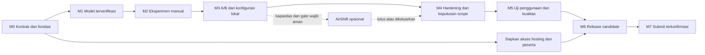

# TomorrowLab — Development Roadmap

**Versi 1.0 · 26 Oktober 2026 · Seluruh jadwal menggunakan WIB**

| Atribut | Baseline |
|---|---|
| Status | Rencana pelaksanaan untuk implementasi; bukan laporan fitur yang sudah selesai |
| Sasaran | MVP simulator antrean kantin yang dapat dipakai manual, menghasilkan statistik yang dapat diulang, dan siap didemonstrasikan |
| Periode pengembangan | 26 Oktober–20 November 2026 |
| Target submit internal | 20 November 2026 pukul 20.00 WIB |
| Deadline resmi | 21 November 2026 pukul 05.00 WIB |
| Feature freeze | 18 November 2026 pukul 12.00 WIB |
| Keputusan AirShift | Paling lambat 13 November 2026 pukul 20.00 WIB |
| Estimasi dasar | 128 jam kerja tim untuk scope wajib +32 jam buffer =160 jam; kapasitas aktual belum dikonfirmasi |
| Prinsip prioritas | Kebenaran model → kontrol manual → perbandingan fair → kualitas penggunaan → submission |

## 1. Tujuan dan cara memakai roadmap

Roadmap ini mengubah lima dokumen TomorrowLab menjadi urutan pekerjaan yang dapat dilaksanakan dan dinilai. Tiap milestone mempunyai hasil pengguna, dependensi, owner peran, kriteria keluar dan bukti yang diperlukan. Tanggal adalah target rencana, bukan bukti progres atau janji kapasitas tim yang belum diketahui.

Target akhir: pengguna baru dapat membuka preset, menambah loket atau pelanggan secara manual, menjalankan dan mengulang percobaan, membandingkan A/B dengan permintaan sama, menyimpan konfigurasi di browser, serta memahami hasil dan keterbatasannya. Kamera tidak menjadi prasyarat satu pun tugas inti.

### Dokumen acuan

| Dokumen | Menentukan |
|---|---|
| [PRD v1.0](/Users/adrian/Documents/Codex/2026-10-26/referenced-chatgpt-conversation-this-is-an/outputs/PRD.md) | Scope, requirements, metrik keberhasilan, jadwal awal dan syarat rilis |
| [USER_FLOW.md](USER_FLOW.md) | 16 alur, guard, input manual, hidden, penyimpanan dan pemulihan |
| [DESIGN_SYSTEM.md](DESIGN_SYSTEM.md) | Token, layout responsif, komponen, state dan aksesibilitas |
| [ARCHITECTURE.md](ARCHITECTURE.md) | Stack, batas modul, worker, protokol, storage, keamanan dan deployment |
| [SIMULATION_SPEC.md](SIMULATION_SPEC.md) | DES, PCG32, seed/identitas, statistik, pairing, ST-01–10 dan SX-01–12 |

Roadmap tidak mengganti kontrak dokumen tersebut. Durasi, kapasitas dan cara pengelompokan pekerjaan boleh dievaluasi ulang; perubahan fenomena model, fairness, privasi atau scope Must memerlukan keputusan produk serta pembaruan dokumen terkait.

### 1.1 Status awal yang benar

- **Tersedia:** lima dokumen spesifikasi dan contoh/golden vector yang telah diperiksa pada tahap dokumentasi.
- **Belum diverifikasi sebagai implementasi:** aplikasi, engine produksi, dependency terpasang, browser runtime, deployment, uji pengguna dan submission.
- **Status awal semua work package:** Belum mulai. Dokumen yang lengkap tidak membuat work package implementasi otomatis Selesai.
- **Belum diketahui:** jumlah anggota, ketersediaan harian, perangkat acuan aktual dan host final. Penetapannya masuk milestone pertama.

## 2. Hasil yang ingin dicapai

| ID | Outcome | Ukuran keberhasilan | Batas pembuktian |
|---|---|---|---|
| OUT-01 | Tim dapat mempercayai perhitungan sebelum memperindah scene | Seluruh fixture, golden vector, invariant dan error path wajib lulus | Verifikasi model, bukan validasi kantin nyata |
| OUT-02 | Pengguna dapat menyelesaikan eksperimen tanpa kamera | Seluruh alur Must memakai manual/keyboard; fallback grafis berfungsi | Uji pada browser dan perangkat yang dicatat |
| OUT-03 | Pengguna membandingkan intervensi pada permintaan yang setara | Tepat 20 pasangan, customer variate sama, CI/N/A dan stale result benar | Hasil sintetis sesuai asumsi model |
| OUT-04 | Pengguna dapat kembali ke konfigurasi yang sama | Save/refresh/load menjaga parameter, seed dan ordinal/jadwal; gagal write tidak merusak data lama | Lokal pada browser, tanpa resume progres runtime |
| OUT-05 | Demo dapat dipahami dan diakses juri | Tugas pertama serta A/B mudah dicoba; tautan publik tanpa login; kiriman terkonfirmasi | Tidak menyebut fitur rencana sebagai fitur selesai |

Target usability mengikuti PRD: ≥ 4 dari 5 peserta menyelesaikan run dan menemukan mean wait dalam ≤ 3 menit, serta ≥ 4 dari 5 menyusun A/B dan menjelaskan arah perubahan dalam ≤ 5 menit setelah tugas awal. Ini uji formatif kecil; tidak menjadi klaim tingkat keberhasilan populasi. Jika peserta tidak tersedia, laporkan gap dan hasil uji internal secara terpisah.

## 3. Kapasitas, peran dan aturan komitmen

### 3.1 Anggaran kerja

| Kelompok | Jam tim | Ketentuan |
|---|---:|---|
| WP-01–11, scope wajib | 128 | Estimasi dasar, termasuk tes pada tiap paket |
| Buffer integrasi, bug dan ketidakpastian | 32 | 20% dari kapasitas rencana 160 jam; bukan daftar fitur tambahan |
| Total baseline | 160 | Batas rencana atas asumsi PRD 120–160 jam |
| AirShift opsional | 8–12 | Di luar komitmen wajib; hanya dialokasikan lewat gate §7 |
| Drag and drop, ekspor dan grafik tambahan | 0 | Tidak dijadwalkan untuk baseline hackathon |

Jam adalah total kerja manusia, bukan durasi kalender dan bukan jam per orang. Dua orang bekerja bersama selama 2 jam mengonsumsi 4 jam tim. Waktu anggota baru untuk membaca dokumen dan koordinasi juga harus dihitung, bukan dianggap gratis.

Sebagai ilustrasi kapasitas, 160 jam dapat berasal dari 2 orang × 4 jam × 20 hari aktif, atau 1 orang × 8 jam × 20 hari aktif. Ini tidak menyatakan anggota tersedia atau merekomendasikan kerja tanpa istirahat. Pada kickoff, ganti ilustrasi dengan ketersediaan nyata, hari libur dan tanggung jawab lain. Jangan membagi 128 jam secara merata lalu menganggap semua hari punya kapasitas sama.

Jika kapasitas yang tersedia hanya 120 jam, estimasi wajib 128 jam sudah kekurangan 8 jam sebelum buffer. Rencana belum layak untuk dikomitmenkan: hapus semua opsional, sederhanakan presentasi dalam scope, evaluasi estimasi dan alokasi kerja, lalu catat gap. Jangan menyatakan rencana aman dengan menghilangkan QA, determinisme atau aksesibilitas dari perhitungan.

### 3.2 Peran

| Kode | Tanggung jawab | Keputusan utama |
|---|---|---|
| P | Pemilik produk dan scope | Memprioritaskan, menerima gate, menjaga klaim dan keterbatasan |
| S | Simulasi dan statistik | Core, RNG, worker contract bersama pengembang UI, fairness |
| U | Pengalaman pengguna | UI, scene, storage, aksesibilitas dan AirShift opsional |
| Q | QA dan verifikasi | Fixture, integrasi, browser, resource dan bukti pass/fail |
| R | Release dan submission | Hosting, materi, kelayakan peserta dan konfirmasi kiriman |

Nama owner diisi pada kickoff. Satu orang boleh merangkap beberapa peran. Pekerjaan paralel hanya boleh diasumsikan bila benar ada kapasitas independen; satu orang tidak dihitung mengerjakan dua paket pada waktu yang sama. Bila memungkinkan, review model dilakukan orang selain penulis; bila solo, gunakan fixture independen dan catat keterbatasan review.

## 4. Peta milestone dan jalur kritis

| Milestone | Jendela target | Outcome dan kriteria keluar ringkas | Owner |
|---|---|---|---|
| M0 — Siap mulai | 26–28 Okt | Scope, kapasitas, perangkat, toolchain, versi dan kontrak data terkunci; proyek dapat dibuild | P/S/U/R |
| M1 — Model dapat dipercaya | 29 Okt–2 Nov | Core menghitung FIFO, horizon/drain dan metrik benar tanpa renderer; fixture dasar/golden lulus | S/Q |
| M2 — Eksperimen manual dapat dipakai | 3–6 Nov | Run/pause/reset/replay, input manual, 3D sederhana dan tampilan ringkas terintegrasi | U/S/Q |
| M3 — Keputusan dapat dibandingkan dan diulang | 7–10 Nov | A/B 20 pasangan, CI/N/A/stale, save/load/delete serta error storage bekerja | S/U/Q |
| M4 — Scope distabilkan | 11–13 Nov | Hardening manual berjalan; putusan AirShift berbukti; tidak ada opsional menggantung | P/U/Q |
| M5 — Layak dipakai orang lain | 14–17 Nov | Uji tugas, browser, aksesibilitas, performa dan privasi; hambatan inti diperbaiki | Q/P |
| M6 — Kandidat rilis diterima | 18–19 Nov | Freeze 18 Nov: semua Must terintegrasi dan bukti awal lulus; 19 Nov regresi final, nol blocker/major dan materi sesuai build | Q/P/R |
| M7 — Terkirim dan dapat diakses | 20 Nov, sebelum 20.00 | Submission diterima; URL/rekaman benar; artefak dan konfirmasi dicatat | R |

Urutan ini mengikuti PRD §13. Pengerjaan worker boleh mulai 1 November setelah potongan API core dan fixture yang dibutuhkan stabil; pengujian serta persiapan submission juga dimulai lebih awal. Overlap tersebut tidak mengubah syarat akhir milestone.

Jalur kritis adalah kontrak → model → integrasi manual → A/B/persistence → QA → release → submit. Scene sederhana dapat dikembangkan setelah bentuk projection stabil. AirShift, drag and drop dan dekorasi bukan prasyarat milestone inti.

## 5. Work package yang dapat dikerjakan

Estimasinya mencakup implementasi, test lokal yang relevan dan satu putaran perbaikan ringan. WP-10 menambah verifikasi lintas sistem; bukan tempat menunda seluruh pengujian sampai akhir. Breakdown ini acuan awal, belum hasil pengukuran velocity tim.

| ID | Pekerjaan wajib dan window target | Jam | Dependensi minimum | Owner / bukti selesai |
|---|---|---:|---|---|
| WP-01 | Bootstrap proyek, kapasitas, toolchain, build dan akses host; 26–28 Okt | 8 | Dokumen baseline | U/R/P; install dari lockfile, typecheck dan build dapat diulang; perangkat/owner tercatat |
| WP-02 | Domain, validator, versi, PCG32 dan seed mapping; 27–29 Okt | 8 | Struktur/bootstrap dasar WP-01 | S; golden vector eksak, seed 0, bounds, ordinal dan serialisasi lulus |
| WP-03 | FIFO DES, scan event, live schedule/log, clock dan drain; 29 Okt–2 Nov | 18 | Kontrak WP-02 | S; ST-01–05/08/10 serta tie/overflow, replay dasar dan invariant lulus |
| WP-04 | Integral, metrik, N/A, P95 dan fixture statistik; 30 Okt–2 Nov | 12 | API state/timestamp WP-03 yang sudah stabil | S/Q; cohort/horizon, countsAtH, identitas integral dan ST-09 benar |
| WP-05 | Worker, controller, ACK, epoch, yield, fast/cancel/hidden; 1–6 Nov | 14 | Potongan core WP-03 dan DTO WP-02 | S/U; worker/direct parity, live timestamp, stale command, pause/cancel dan handshake lulus |
| WP-06 | Workspace, seluruh kontrol manual, state dan keyboard; 3–6 Nov | 16 | DTO/protokol stabil WP-02/05 | U; UF-01–08 end-to-end, manual add loket/pelanggan, form error, fokus dan responsive dasar |
| WP-07 | Scene 3D sederhana, camera controls dan CompactScene; 4–6 Nov | 8 | Projection WP-05, layout WP-06 | U; grafis gagal tidak mematikan model; avatar ≤ 150; angka canonical penuh |
| WP-08 | A/B 20 pasangan, CRN, CI, empty/stale/cancel/suspend; 7–10 Nov | 12 | WP-03/04/05, entry UI WP-06 | S/U; ST-06/07/09, SX-08/12, fairness dan hasil lama benar |
| WP-09 | Save/load/delete, Web Locks, validasi record dan konflik; 7–10 Nov | 8 | Domain WP-02 dan UI WP-06 | U; UF-12/13, slot 10, write gagal, unsupported schema dan konflik tab diuji |
| WP-10 | Hardening, uji peserta, browser, aksesibilitas, performa, privasi dan regresi; 11–19 Nov | 16 | Vertical slice WP-03–09; dilakukan bertahap | Q/P; checklist terkait, issue retest dan bukti gate selesai |
| WP-11 | Build produksi, demo, materi dan submission; persiapan 10 Nov, utama 18–20 Nov | 8 | Hosting WP-01; build stabil WP-08/09/10 untuk final | R/P; URL publik, rekaman sesuai fitur aktual, form dan konfirmasi submit |
| **Total** | **Scope wajib** | **128** | Buffer 32 jam terpisah | Belum merupakan realisasi jam |

Dependensi terhadap potongan API stabil tidak berarti paket induk telah Selesai. Paket berikut boleh mengembangkan UI memakai fixture/adapter test, tetapi gate end-to-end tetap membutuhkan engine asli. Jangan mengganti hasil engine dengan mock saat menyatakan milestone produk lulus.

## 6. Exit criteria dan rencana review milestone

### M0 — Siap mulai

Keluaran: owner bernama, kapasitas aktual dan hari aktif; package/runtime versions dipin; skeleton build; satu host HTTPS uji; kontrak versi dan identitas manual disepakati. Periksa syarat peserta serta akses akun/form lomba oleh pemilik akun. Kunci perangkat acuan dan versi browser yang akan diuji.

**Gate G0:** build/typecheck dasar berhasil, kontrak SIMULATION_SPEC dan ARCHITECTURE tidak ambigu, serta kapasitas rencana dapat dipertanggungjawabkan. Jika gagal, selesaikan fondasi dan revisi alokasi; jangan menghabiskan waktu membuat artwork/dekorasi.

### M1 — Model dapat dipercaya

Keluaran: core murni dapat diuji tanpa React/3D. PCG golden vectors eksak; arrival dan service streams terpisah; FIFO/tie/lowest-idle/horizon/drain benar; jadwal dasar dan log live dieksekusi sekali. Integral full versus horizon, provisional denominator, N/A dan P95 mengikuti spec.

**Gate G1:** fixture dasar dan invariant lulus; tidak ada perhitungan dari avatar/timer nyata; seed/log/versi sama menghasilkan hasil sama. Corpus/distribution tests mulai dijalankan dan seluruh kegagalan ditangani sebelum release gate. API/projection yang diperlukan worker sudah stabil.

Jika gate belum lulus 2 November, tandai jalur kritis tertinggal, hilangkan alokasi opsional sementara dan gunakan buffer untuk akar masalah. UI presentasi boleh diteruskan dengan fixture berlabel untuk integrasi, tetapi tidak disebut simulasi valid.

### M2 — Eksperimen manual dapat dipakai

Keluaran: pengguna mengubah parameter di READY, menambah loket/pelanggan dengan klik/keyboard, run/pause/resume/reset/replay dan Selesaikan cepat. Manual input distempel worker; pause sah pada interval tanpa event; hidden tidak catch-up atau auto-resume. Ada scene 3D sederhana serta alternatif DOM lengkap.

**Gate G2:** UF-01–08 dan UF-14/15 dapat dijalankan; pause/cancel responsif pada perangkat acuan; duplicate/stale command dan reset epoch tidak menggandakan pelanggan. Parameter terkunci selama run; pending input dibedakan dari arrived. Data model tetap sama pada speed/FPS/reduced motion berbeda.

Jika 6 November kontrol inti belum menyatu, prioritaskan engine-worker-UI dan fallback. Pangkas animasi/kerumitan scene; jangan mengganti 3D dengan rencana kosong atau mengorbankan semantik manual.

### M3 — Pilihan dapat dibandingkan dan konfigurasi diulang

Keluaran: baseline A dan kandidat B; permintaan/seed/identitas sama; 20 pasangan; summary delta/CI; N/A saat pasangan kosong; snapshot stale; simpan/muat/hapus lokal yang tervalidasi. Siapkan alamat demo uji dan daftar peserta uji.

**Gate G3:** ST-06/07/09, SX-08–12 serta jalur UF-09–13 lulus; A=B memberi delta 0/CI[0; 0] hanya jika seluruh pasangan berisi pelanggan. Gagal/cancel satu replikasi tidak menghasilkan summary palsu. Storage gagal mempertahankan draft dan data valid; schema rusak tidak dibersihkan otomatis.

Jika 10 November A/B atau persistence wajib belum selesai, AirShift otomatis tidak mendapat komitmen waktu sampai jalur wajib pulih. Dua run acak tak berpasangan tidak boleh dipakai sebagai pengganti perbandingan fair.

### M4 — Scope stabil dan opsional diputuskan

Keluaran wajib: daftar issue terurut, benchmark awal, uji browser/fallback dimulai, peserta uji dijadwalkan dan status AirShift jelas. Keputusan AirShift dicatat paling lambat 13 November 20.00 WIB, dengan bukti atau alasan dikeluarkan.

**Gate G4:** tidak ada fitur opsional yang masih “mungkin dipasang nanti” di build submission. Build manual tetap berfungsi bila AirShift tidak disertakan. Gate gesture lengkap dijelaskan di §7; lulus spike teknis saja tidak sama dengan lulus gate produk/privasi.

### M5 — Produk dapat dipakai orang lain

Keluaran: hasil tugas formatif, browser/viewport/zoom/keyboard/screen reader checks, stress/resource, error storage, WebGL gagal, lifecycle dan privasi. Jalankan semua ST/SX, corpus ≥ 100 seed dan sanity distribution ≥ 100.000 sampel per kelompok sesuai spesifikasi. Tetapkan hasil pass/fail dengan build dan perangkatnya.

**Gate G5:** masalah yang menghalangi tugas inti diperbaiki; semua Must memiliki bukti atau issue yang jelas menuju penutupan. G-01/G-02 PRD diuji bila peserta tersedia; gagal target berarti ada hambatan yang perlu diperbaiki, bukan alasan mengubah denominator peserta. Jika rekrutmen gagal, catat keterbatasan dan lakukan uji internal tanpa klaim validasi pengguna.

### M6 — Release candidate diterima

Pada 18 November 12.00 WIB seluruh Must ditargetkan sudah terintegrasi dengan bukti awal lulus, lalu penambahan fitur dihentikan. 19 November dipakai untuk verifikasi regresi final, bukan pengujian pertama fitur wajib. Pekerjaan sesudah freeze hanya bugfix yang perlu, retest, akses demo dan materi submission. Ubah build release candidate setiap ada perbaikan; perbarui bukti yang terdampak. Bila ada Must belum lulus saat freeze, catat gate tertinggal dan fokus menutup gap; tanggal freeze tidak membuat paket otomatis selesai.

**Gate G6, paling lambat 19 November 20.00 WIB:** semua FR/NFR wajib memenuhi kriteria yang berlaku, seluruh ST/SX dan gate relevan lulus, nol blocker/major, URL produksi diuji di profil browser baru, build/worker/model assets cocok, serta deskripsi/rekaman sesuai kemampuan aktual. Jika gagal, lanjutkan penutupan issue wajib dan pertahankan penilaian rilis jujur; tidak melabeli MVP lulus karena kalender mendesak.

### M7 — Submission terkonfirmasi

**Gate G7, 20 November 20.00 WIB:** form terkirim dan statusnya dikonfirmasi pada akun pemilik; URL proyek, demo/rekaman, kontribusi, teknologi, keterbatasan dan credits benar. Simpan bukti pengiriman dan identitas build; buka kembali tautan melalui profil yang tidak login ke akun pengembang. Owner R bertanggung jawab pada pengiriman; roadmap ini tidak mengirimkan apa pun.

Setelah target internal, gunakan buffer 9 jam hanya untuk gangguan kiriman/akses dan blocker yang benar-benar perlu. Hindari mengganti build yang telah terkirim hanya untuk perapian kosmetik. Deadline resmi 21 November 05.00 WIB tetap batas akhir [R1].

## 7. Gate dan timebox AirShift

AirShift adalah Should, bukan Must. Window 11–13 November tidak berarti seluruh window wajib dipakai untuk gesture. Hardening manual berlangsung meskipun AirShift tidak dikerjakan.

### 7.1 Syarat mulai

1. G0–G3 lulus dan tidak ada blocker/major pada model, fairness, manual controls atau persistence.
2. Perkiraan jam wajib tersisa, kapasitas nyata dan cadangan sudah diperbarui berdasarkan realisasi, bukan perasaan bahwa pekerjaan “hampir selesai”.
3. Setelah alokasi opsional, buffer yang diproyeksikan untuk integrasi/QA/release masih ≥ 24 jam.
4. Ada perangkat/kamera dan peserta yang diperlukan untuk gate kualitas; tidak mengandalkan kamera presenter saja.

Pada baseline 160 jam, 128 jam wajib meninggalkan 32 jam buffer. Mengalokasikan 8 jam opsional menyisakan 24 jam; 12 jam menyisakan 20 jam dan **tidak memenuhi gate**, kecuali ada ≥ 4 jam penghematan terverifikasi atau kapasitas tambahan nyata. Rumus review: kapasitas tersisa − estimasi wajib tersisa − opsional yang diusulkan ≥ 24 jam. Jangan menghitung jam yang sudah dipakai sebagai kapasitas tersisa.

### 7.2 Pelaksanaan dan keputusan

| Bagian | Batas rencana | Bukti minimum |
|---|---:|---|
| Spike teknis | Maksimal 2 jam awal, termasuk dalam total 8–12 | Inferensi lokal/worker, model/lisensi, permission/stop track dan latency layak |
| Integrasi terbatas | Dalam sisa timebox | Hanya pause/resume, dwell/re-arm/cooldown/stale/hidden sesuai kontrak; manual tetap utuh |
| Verifikasi produk/privasi | Termasuk dalam timebox; tidak dihapus agar fitur sempat masuk | Gate lengkap PRD §9.3 dan inspeksi network/track lifecycle |

Gate produk: minimal 3 orang × 2 kondisi cahaya × 10 percobaan per pose, keberhasilan ≥ 90% dalam ≤ 2 detik; ≥ 10 menit gerakan non-perintah dengan nol aksi palsu; kamera ditolak/tidak ada/dicabut; tidak ada upload atau penyimpanan frame. Jika waktu atau peserta tidak cukup, keputusan adalah no-go.

**Go:** semua bukti lulus dan buffer masih aman. **No-go:** entry point, lazy asset yang tidak diperlukan dan klaim fitur dihapus dari build submission; dokumen/rekaman menyatakan AirShift belum termasuk versi yang disubmit. Tidak memaksa ship dengan label beta bila privasi/latency belum terbukti.

## 8. Pengendalian scope dan pemulihan keterlambatan

| Urutan | Yang dipotong/disederhanakan | Yang tetap wajib |
|---|---|---|
| 1 | Drag and drop, ekspor, grafik tambahan, preset tambahan | Satu preset sah, input manual lengkap, hasil numerik jelas |
| 2 | AirShift bila gate/kapasitas gagal | Kamera off dapat menyelesaikan seluruh tugas inti |
| 3 | Dekorasi scene, animasi, jumlah avatar visual | Scene 3D sederhana, CompactScene dan count canonical penuh |
| 4 | Presentasi komponen tambahan yang tidak dibutuhkan tugas | State, field error, keyboard, konfirmasi dan responsive/reduced motion |
| 5 | Pekerjaan pascalomba | Model, RNG, pairing, cohort/horizon, persistence dan QA rilis tidak dikurangi |

Jangan memotong seed/log, 20 pasangan, drain, validasi, penanganan data gagal, akses keyboard atau privasi sebagai “optimasi waktu”. Jika scope wajib tetap tidak muat setelah pemotongan, nyatakan gap dan ubah keputusan rilis secara eksplisit; jangan menyebutnya MVP lengkap.

### Pemicu eskalasi internal

| Pemicu | Tindakan |
|---|---|
| Satu gate kritis mundur>1 hari | Owner memperbarui estimasi sisa, dependensi dan penggunaan buffer pada hari yang sama |
| Total forecast wajib+buffer melampaui kapasitas nyata | Hentikan opsi tambahan; review alokasi dan penyederhanaan dalam scope sebelum menambah komitmen |
| Bug model/fairness muncul kapan pun | Prioritas tertinggi; hentikan klaim statistik/demonstrasi hasil sampai verifikasi pulih |
| Must belum lengkap saat 18 November freeze | Freeze tetap berlaku; kerjakan bug/gap wajib, tanpa fitur baru atau pernyataan gate lulus palsu |
| Hosting/akun belum bisa dipakai 19 November | Owner R menangani akses segera, gunakan host cadangan yang telah diuji bila perlu; rekaman pendukung sesuai aturan |
| Submission belum terkonfirmasi 20 November 20.00 | Fokus penuh pada kiriman/akses; tidak menunda sampai jam terakhir untuk polish |

## 9. Risiko dan dependensi yang harus dipantau

| Risiko/dependensi | Checkpoint | Owner dan mitigasi |
|---|---|---|
| Kapasitas anggota belum diketahui | G0; review singkat tiap hari aktif | P menetapkan jam nyata, memperbarui forecast; tidak mengasumsikan paralel gratis |
| Kontrak model/worker berbeda saat integrasi | M1→M2 | S/U memakai DTO/versi yang sama, parity dan race tests sebelum polish |
| RNG/counter manual bergeser saat promosi/replay | G1/G3 | S memeriksa golden vector, identity mapping dan SX-10 |
| Driver/WebGL2/perangkat tidak cukup | Benchmark awal M2; lengkap M5 | U memakai scene sederhana, batas avatar dan CompactScene |
| Web Locks/storage browser tidak tersedia | M3 dan browser wajib M5 | U/Q memeriksa save/load sukses pada browser QA; fallback memori bukan bukti persistence lulus |
| Inferensi gesture mengganggu kontrol | Spike maksimal 2 jam, keputusan 13 Nov | U menonaktifkan AirShift bila latency/privasi tidak lulus |
| Peserta uji sulit didapat | Mulai undang paling lambat 10–12 Nov | P/Q menjadwalkan lebih awal; catat gap bila hanya internal |
| Host atau CSP/worker asset berbeda dari dev | Host uji G0; smoke M3; final M6 | R menguji build produksi, base path, MIME, HTTPS dan cache |
| Akun/eligibility/aturan submission | G0 lalu cek ulang M6 | Pemilik akun R memeriksa aturan resmi; status eligible tidak diasumsikan |
| Deadline/timezone disalahpahami | G0 dan 20 Nov | Gunakan WIB di semua catatan; cek halaman resmi kembali |

Detail risiko domain mengikuti risk register PRD. Roadmap tidak menambah backend, akun atau data lapangan untuk mengatasi risiko yang belum menjadi kebutuhan MVP.

## 10. Proses kerja dan definisi Selesai

### 10.1 Status pekerjaan

Gunakan Belum mulai → Dikerjakan → Ditinjau → Terverifikasi. Status Terblokir menyertakan sebab, owner, tindakan pemulihan dan tanggal review. **Terverifikasi** memerlukan bukti, bukan hanya kode sudah ditulis atau merge sudah dilakukan. Saat bukti gagal setelah perubahan baru, buka kembali status paket/gate yang terdampak.

Satu orang memegang maksimal satu paket utama aktif; reviewer dapat memberi review singkat tanpa dianggap mengerjakan dua paket penuh sekaligus. Dalam tim, S dan U boleh mengerjakan paket independen setelah kontrak stabil. Jangan memperbanyak pekerjaan parsial untuk memberi kesan progres.

### 10.2 Review singkat pada hari aktif

Catat hasil terakhir yang benar-benar lulus, blocker, jam realisasi, estimasi sisa dan gate berikut. Bandingkan forecast dengan tanggal, bukan sekadar persentase checklist. Bila ada perubahan scope, catat keputusan dan sumber dokumen yang diperbarui. Tidak perlu rapat panjang atau tracker baru; tabel isu/PR yang sudah dipakai tim cukup.

### 10.3 Bukti wajib per paket/gate

| Bukti | Isi minimum |
|---|---|
| Pengujian model | ID ST/SX/golden, input/seed/versi, expected/actual, pass/fail |
| Pengujian integrasi/UI | Flow/requirement, build, browser, perangkat, langkah dan hasil |
| Benchmark | Konfigurasi, network/viewport yang relevan, durasi/latency/FPS dan keterbatasan |
| Bugfix | Masalah, perubahan, uji regresi dan status retest |
| Usability | Tugas, jumlah peserta, durasi, bantuan yang diperlukan, hasil tanpa identitas pribadi yang tidak perlu |
| Release/submission | Build/URL, checklist final, timestamp WIB dan konfirmasi kiriman |

Lokasi bukti boleh mengikuti workflow proyek saat implementasi; roadmap ini tidak membuat file test report atau tracker kosong. Hasil simulasi sensitif terhadap versi; jangan memakai laporan build lama tanpa menilai dampak perubahan.

### 10.4 Definition of Done rilis

- Semua FR/NFR wajib dan exit criteria relevan terpenuhi; nol blocker/major terbuka.
- Seluruh ST-01–10, SX-01–12, golden vector, invariant corpus dan sanity distribution sesuai spec lulus.
- Semua tugas manual, statistik dan A/B berjalan tanpa kamera; 3D serta alternatif tekstual tersedia sesuai target perangkat.
- Replay/snapshot/log dan seed version konsisten; data kosong, parsial, invalid dan stale tidak tampil sebagai hasil final valid.
- Save/load/delete lulus pada browser wajib; penolakan storage/conflict tidak merusak data lama.
- Keyboard, focus, zoom 200%, viewport kecil, reduced motion dan screen reader telah diuji sesuai checklist.
- Jika AirShift dirilis, gate kualitas/privasi lulus; jika tidak, build dan materi tidak mengklaimnya tersedia.
- Demo publik tanpa login dan kiriman dapat dibuka pihak lain; deskripsi mengungkap asumsi sintetis dan keterbatasan nyata.

## 11. Submission, buffer dan masa penjurian

Deadline resmi Devpost adalah 20 November 2026 pukul 17.00 EST [R1]. EST UTC−5 ke WIB UTC+7 memberi selisih 12 jam: 21 November 2026 pukul 05.00 WIB. Target internal 20 November 20.00 WIB memberi buffer 9 jam. Halaman resmi tetap menjadi acuan jika penyelenggara mengubah jadwal.

| Waktu WIB | Tindakan | Kriteria |
|---|---|---|
| 18 Nov, 12.00 | Feature freeze | Seluruh Must terintegrasi dengan bukti awal lulus; scope submission jelas; hanya bugfix/regresi/materi sesudahnya |
| 19 Nov, 20.00 | Gate release candidate | G6 lulus; build dan URL final diperiksa |
| 20 Nov, ≤ 20.00 | Submit dan verifikasi | G7 lulus; status terkirim dan tautan benar |
| 20 Nov 20.00–21 Nov 04.00 | Buffer operasional | Hanya gangguan akses/kiriman dan blocker; tidak ada fitur baru |
| 21 Nov 04.00 | Pemeriksaan terakhir | Status submission, URL dan materi diperiksa; satu jam terakhir tidak direncanakan sebagai waktu kerja normal |
| 21 Nov 05.00 | Deadline resmi | Kiriman sudah diterima sebelum batas ini |
| Hingga 26 Nov 05.00 setidaknya | Jaga akses demo/tautan | Menutup akhir jadwal penjurian 25 Nov 17.00 EST; tidak mengubah klaim fitur sesudah deadline |

Aturan resmi meminta halaman proyek lengkap dan demo/build/walkthrough yang dapat diakses, penjelasan kontribusi serta keterbatasan, dan tautan tetap tersedia selama penjurian [R2]. Verifikasi hak penggunaan aset/library dan disclosure alat sesuai aturan. Ini kebutuhan materi submission; tidak menambahkan tanda tangan atau atribusi AI pada commit/PR.

Siapkan rekaman walkthrough pendukung dari build yang sama setelah perilaku utama stabil. Jangan mengganti demo fungsional dengan video yang menyatakan fitur belum ada sebagai tersedia. Bila ada gangguan pascadeadline, pulihkan akses ke artefak yang sudah disubmit dan ikuti ketentuan resmi; hindari memasukkan kapabilitas baru tanpa penjelasan.

## 12. Arah pascalomba

Semua item berikut aspirasi, tanpa tanggal atau komitmen implementasi. Urutan dipilih dari bukti penggunaan, bukan karena tercantum di roadmap.

| Tahap | Outcome yang dicari | Kandidat pekerjaan | Syarat lanjut |
|---|---|---|---|
| Evaluasi | Mengetahui bagian produk yang berguna dan membingungkan | Tinjau feedback juri/uji pengguna, bug dan biaya pemeliharaan | Ada masalah spesifik dengan bukti dan owner |
| Validasi domain | Menguji apakah asumsi sesuai kantin nyata | Pengumpulan data yang sah, distribusi, kalibrasi dan validasi terpisah | Izin/data memadai, batas klaim serta evaluasi statistik jelas |
| Analisis lebih kaya | Membantu keputusan yang benar-benar diminta pengguna | Sensitivitas, loket heterogen, jadwal kapasitas atau disiplin antrean lain | Pertanyaan pengguna nyata dan modelVersion/test baru |
| Ekspansi produk | Membuat eksperimen lebih mudah dipakai kembali | Berbagi konfigurasi, riwayat besar, domain baru atau gesture lebih luas | Kebutuhan terbukti, studi privasi/security dan arsitektur yang diperlukan |

Tidak membangun cloud/auth, editor dunia bebas, optimasi AI, banyak jalur antrean atau multi-domain selama hackathon untuk menyiapkan aspirasi ini.

## 13. Langkah pertama setelah roadmap

Mulai WP-01 dan kontrak WP-02: isi owner serta kapasitas aktual, tetapkan perangkat QA, pin toolchain, buat build statis minimal dan pasang test harness. Implementasikan validator/versi/PCG beserta golden vector sebelum DES dan scene. Gunakan gate M0 untuk menerima fondasi, lalu lanjutkan core sesuai jalur kritis.

Penyusunan roadmap ini hanya menghasilkan dokumen perencanaan. Tidak menginisialisasi proyek, menulis aplikasi, memasang dependency, membuat tiket eksternal, melakukan deployment, menjadwalkan otomatisasi atau mengirim submission.

## 14. Referensi dan riwayat

- **[R1]** [LaunchPad Hacks — Schedule resmi](https://launchpad-hacks.devpost.com/details/dates), diperiksa 26 Oktober 2026. Deadline 20 Nov 17.00 EST; penjurian berakhir 25 Nov 17.00 EST. Konversi WIB dan buffer adalah perhitungan rencana ini.
- **[R2]** [LaunchPad Hacks — Rules resmi](https://launchpad-hacks.devpost.com/rules), diperiksa 26 Oktober 2026. Acuan eligibility, karya/sumber, materi submission dan akses tautan. Peserta tetap memeriksa versi resmi sebelum submit.
- Dokumen internal pada §1 menjadi acuan detail teknis; roadmap tidak mengulang atau mengubah definisi statistiknya.

| Versi | Tanggal | Catatan |
|---|---|---|
| 1.0 | 26 Oktober 2026 | Roadmap implementasi awal: 8 milestone, 11 work package wajib, kapasitas/buffer, gate kualitas, AirShift opsional dan pelaksanaan submission. |
