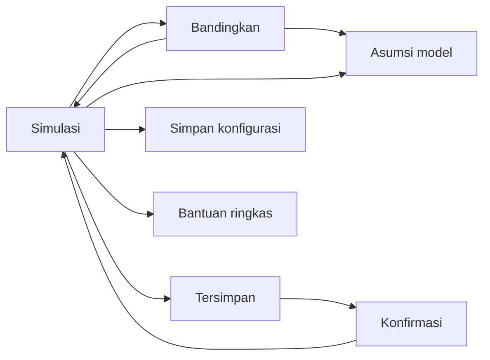
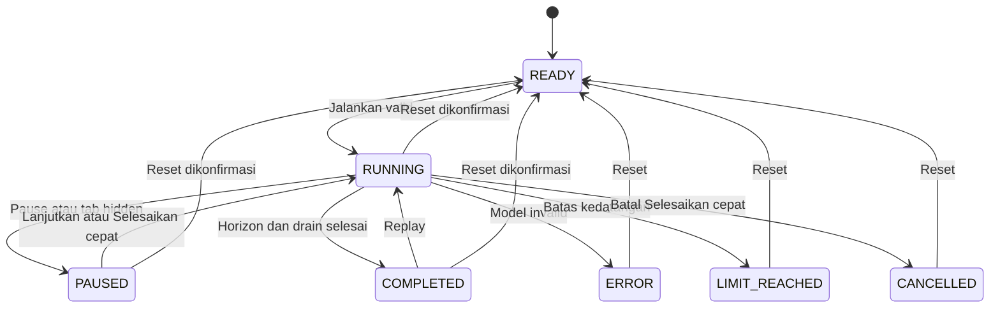

# TomorrowLab — User Flow

**Versi 1.0 · 26 Oktober 2026 · Bahasa Indonesia**

| Atribut | Ketentuan |
|---|---|
| Status | Spesifikasi interaksi untuk implementasi; aplikasi dan pengujiannya belum diverifikasi |
| Acuan utama | [PRD v1.0](/Users/adrian/Documents/Codex/2026-10-26/referenced-chatgpt-conversation-this-is-an/outputs/PRD.md), terutama §5–12 |
| Pendamping | [Design System v1.0](DESIGN_SYSTEM.md) untuk tampilan, token, komponen, dan pola aksesibilitas |
| Lingkup | Satu workspace, 16 flow, kontrol manual lengkap, A/B berpasangan, penyimpanan browser, pemulihan, AirShift opsional |
| Prioritas | Kontrak PRD mengikat; keputusan turunan UX di §8 melengkapi bagian yang belum menentukan urutan interaksi |

Dokumen ini menjelaskan pemicu, aksi pengguna, respons sistem, batas state, dan keluaran yang harus terlihat. Dokumen tidak menentukan framework, struktur kode, atau rencana pelaksanaan. Istilah **final** hanya digunakan untuk run `COMPLETED` atau summary A/B yang lolos seluruh syaratnya. Semua hasil merupakan eksperimen sintetis, belum terkalibrasi terhadap kantin nyata.

## 1. Navigasi dan area pengalaman

Semua area berikut berada dalam satu workspace. ID menamai viewport atau region untuk handoff; tidak mewajibkan rute URL terpisah.

| ID | Area dan entry point | Isi utama | Exit / kembali |
|---|---|---|---|
| SCR-01 | Tab **Simulasi**, default saat membuka aplikasi | Draft/snapshot aktif, scene, toolbar, waktu/phase, metrik, log pelanggan | Tab Bandingkan; drawer; dialog; keluar browser |
| SCR-02 | Tab **Bandingkan**, atau **Jadikan baseline A** | A/B, parameter terkunci, diff, progres 20 pasangan, hasil dan interpretasi | Simulasi; drawer; snapshot hasil sebelumnya |
| SCR-03 | Drawer **Tersimpan** dari toolbar | Maksimal 10 konfigurasi, muat, hapus, status storage | Tutup; muat ke SCR-01; konfirmasi SCR-06 |
| SCR-04 | Dialog **Simpan konfigurasi** | Nama, sumber konfigurasi, pilihan catatan manual, target slot | Simpan berhasil lalu tutup; Batal/Escape |
| SCR-05 | Drawer **Asumsi model** dari workspace/hasil | FIFO, distribusi, kondisi awal, horizon/drain, batas, versi dan sifat sintetis | Tutup ke pemicu |
| SCR-06 | Dialog **Konfirmasi** dari aksi yang membuang/mengganti data | Objek terdampak, konsekuensi, Batal, aksi spesifik | Batal/Escape; konfirmasi menuju tujuan aksi |
| SCR-07 | Panel **AirShift**, hanya bila dirilis | Opt-in, izin, instruksi dua pose, status, matikan | Tutup panel; Matikan AirShift |
| SCR-08 | **Bantuan ringkas** dari kunjungan pertama/toolbar | Empat tugas: run, edit, tambah pelanggan, A/B | Lewati/Selesai/Tutup ke workspace |

Header mempertahankan tab utama, judul konfigurasi, dan status tersimpan. Waktu simulasi, status run, phase, dan identitas parameter yang sedang dieksekusi tetap mudah ditemukan ketika panel lain terbuka. Membuka Bantuan, Asumsi, Tersimpan, atau dialog Simpan tidak dengan sendirinya menghentikan model. UI menyatakan **“Simulasi tetap berjalan”** bila relevan; pengguna dapat memilih Pause sebelum melanjutkan.

## 2. Kontrak state dan data yang terlihat

### 2.1 State run

Nama state internal dipertahankan agar QA dan implementasi memakai istilah sama; UI memakai label Indonesia. `arrivalsOpen` dan `draining` adalah phase terpisah, bukan pengganti state.

| State | Label / tampilan | Aksi utama | Batas |
|---|---|---|---|
| READY | Siap dijalankan | Edit, jadwal, simpan, Jalankan | Belum ada waktu/progres run aktif |
| RUNNING | Berjalan; metrik sementara | Pause, speed, tambah pelanggan sebelum H, Selesaikan cepat, reset | Parameter fisik dan seed terkunci |
| PAUSED | Dijeda + alasan | Lanjutkan, Selesaikan cepat, reset; tambah pelanggan bila t<H | Waktu dan metrik tidak maju; input manual menunggu diproses |
| COMPLETED | Selesai · hasil final | Tinjau, Replay, Jadikan A, simpan, reset | Seluruh cohort selesai melalui drain |
| ERROR | Perhitungan dihentikan | Lihat sebab, salin rincian non-sensitif, reset | Data parsial tidak final; tidak dapat resume |
| LIMIT_REACHED | Batas percobaan tercapai | Tinjau jumlah terakhir, reset dan kurangi beban | Tidak menerima pelanggan pemicu ke-2.001; bukan hasil valid |
| CANCELLED | Run dibatalkan | Tinjau sebab, reset | Khusus pembatalan Selesaikan cepat; tidak dapat resume |

Selesaikan cepat adalah mode eksekusi di `RUNNING`, bukan state canonical baru. Progres batch dan kondisi **ditangguhkan** adalah state UI pekerjaan perbandingan; bukan state run tambahan. Satu komputasi model saja boleh aktif: run visual, Selesaikan cepat, dan batch A/B saling eksklusif. Run yang sudah dijeda boleh tetap tersimpan di memori saat batch bekerja, tetapi tidak diproses bersamaan.

### 2.2 Identitas percobaan dan input manual

- **Draft** adalah konfigurasi yang boleh diedit di READY. Jalankan membuat snapshot parameter immutable. Seed, versi, dan sumber input tercantum pada hasil.
- `manualSchedule` adalah jadwal dasar sebelum run. `inputLog` hanya tambahan pelanggan yang diterima selama RUNNING/PAUSED. Keduanya dieksekusi masing-masing sekali.
- **Reset** menghapus runtime, hasil run, dan `inputLog` tambahan; mempertahankan parameter, root seed, serta jadwal dasar. Reset tidak menghapus slot tersimpan atau summary A/B lengkap.
- **Replay** memakai snapshot dan log yang sama. Ia bukan reset dan tidak menggabungkan ulang log ke jadwal dasar.
- Saat catatan run dipakai untuk simpan/A/B, gabungkan jadwal dasar dan log tambahan menjadi satu jadwal baru dengan identitas/urutan tetap. Run baru mulai dengan log kosong.
- Nilai hasil tetap terikat snapshot asal. Mengedit draft tidak menghitung ulang atau mengganti angka hasil sebelumnya.

## 3. Flow utama

### UF-01 — Membuka workspace dan menemukan tugas pertama

**Entry:** kunjungan baru atau refresh. **Exit berhasil:** READY yang dapat dijalankan manual. **Terkait:** FR-01, 28; NFR-05, 15.

| Langkah / aksi pengguna | Respons sistem | Feedback / fokus | Guard dan alternatif |
|---|---|---|---|
| 1. Buka aplikasi | Muat preset Jam makan siang: c=2, λ=4/menit, layanan 20–40 detik, H=900 detik, seed=2026 | SCR-01, READY, kamera off, playback 20× | Tidak meminta login/kamera; startup tidak menunggu model gesture |
| 2. Baca atau lewati bantuan | Jelaskan Run, Ubah skenario, Tambah pelanggan, Bandingkan | **Lewati** dan **Mulai mencoba** setara; bantuan bisa dibuka lagi | Tidak menutupi akses permanen ke kontrol |
| 3. Periksa parameter/asumsi | Tampilkan label sintetis, ringkasan FIFO dan horizon | Link **Asumsi model**; info beban default dekat kapasitas | Info ρ≥1 bukan error |
| 4. Pilih Jalankan | Lanjut ke UF-04 setelah validasi | Tombol memiliki nama yang jelas untuk screen reader | Storage/grafis gagal memakai fallback tanpa memblokir tugas |

Refresh tidak memulihkan progres run atau hasil sesi. Slot yang berhasil disimpan tetap dapat dibuka melalui Tersimpan; aplikasi tidak menyamakan slot tersimpan dengan run yang sedang dilanjutkan.

### UF-02 — Mengedit parameter dan memeriksa kelayakan input

**Entry:** READY; dari state lain melalui Ubah skenario → UF-08. **Exit:** draft valid atau error field yang dapat diperbaiki. **Terkait:** FR-02–04, 09, 15, 27.

| Langkah / aksi pengguna | Respons sistem | Feedback / fokus | Guard dan alternatif |
|---|---|---|---|
| 1. Tambah/kurangi loket atau ketik c | Perbarui draft, jumlah teks dan scene | Identitas loket tetap dapat dibaca tanpa scene | Integer 1–6; tombol batas disabled dengan alasan |
| 2. Ubah λ melalui slider/angka | Sinkronkan kedua kontrol | Satuan pelanggan/menit; nilai 0 sah | Rentang 0–20, step UI 0,1; tidak diam-diam clamp |
| 3. Ubah layanan, H, seed | Validasi input yang selesai diedit; simpan teks invalid sampai diperbaiki | Error terhubung ke field; Jalankan memfokuskan error pertama | a/b integer 1–300, b≥a; H 60–1.800 detik step 60; seed integer 0–4.294.967.295 |
| 4. Tinjau ringkasan | Hitung indikasi beban otomatis | **“Antrean dapat terus bertambah selama jam kedatangan.”** | Bila ada manual: ρ tidak mencakup lonjakan manual |

Nilai kosong, non-finite, pecahan integer, atau rentang invalid menahan run; tidak dibulatkan otomatis. λ=0 dan jadwal kosong memberi informasi **“Tidak ada pelanggan terjadwal”**, tetapi run tetap sah. Mengurangi H hingga jadwal keluar rentang menandai entry terkait; jangan menghapus entry otomatis.

### UF-03 — Menyiapkan jadwal pelanggan manual

**Entry:** READY, bagian Jadwal pelanggan. **Exit:** jadwal dasar valid dalam draft. **Terkait:** FR-06; NFR-12.

| Langkah / aksi pengguna | Respons sistem | Feedback / fokus | Guard dan alternatif |
|---|---|---|---|
| 1. Pilih Tambah jadwal | Buka input waktu simulasi dan jumlah | Label format waktu/satuan eksplisit | Bukan waktu nyata atau waktu kalender |
| 2. Isi lalu Tambahkan | Validasi dan buat entry beridentitas stabil | Baris menampilkan waktu, jumlah, asal terjadwal | 0≤t<H; count integer 1–20 |
| 3. Tambah entry waktu sama | Pertahankan sequence penerimaan | Tabel urut waktu lalu sequence | Tidak menggabungkan identitas diam-diam |
| 4. Hapus entry draft | Hapus hanya baris terpilih | Fokus ke baris berikutnya/sebelumnya atau Tambah jadwal | Belum ada progres run yang dibuang; tidak perlu dialog per baris |
| 5. Jalankan | Bekukan jadwal dalam snapshot | Ringkasan jumlah pelanggan terjadwal | Total jadwal >2.000 ditolak sebelum run |

Jadwal boleh berdampingan dengan arus otomatis. Menghapus baris tidak mengubah arus otomatis. Error menyebut waktu/jumlah/baris yang harus diperbaiki; run tidak memulai sebagian jadwal yang valid sambil mengabaikan bagian invalid.

### UF-04 — Jalankan, pause, lanjutkan, dan ubah playback

**Entry:** READY valid atau PAUSED. **Exit:** PAUSED, run berlanjut, atau UF-06/07. **Terkait:** FR-07, 09–10, 25; NFR-01–02.

| Langkah / aksi pengguna | Respons sistem | Feedback / fokus | Guard dan alternatif |
|---|---|---|---|
| 1. Tekan Jalankan | Bekukan snapshot; mulai waktu simulasi | RUNNING, **Sementara**, phase Kedatangan dibuka | Cegah klik ganda dan komputasi bersamaan |
| 2. Pilih 1×/5×/20× | Ubah pacing tampilan saja | Pilihan aktif terlihat; default 20× | Seed, event, waktu layanan dan hasil tidak berubah |
| 3. Tekan Pause | Berhenti memajukan waktu/model | PAUSED; tombol menjadi Lanjutkan pada posisi fokus yang sama | Tidak mengulang event saat lanjut |
| 4. Tekan Lanjutkan | Proses kejadian berikut dari state yang sama | RUNNING; alasan pause dihapus setelah aksi sah | Pause hidden memerlukan aksi manual eksplisit |
| 5. Buka drawer/dialog informasi | Model tetap sesuai state sebelumnya | Jika RUNNING tampil **Simulasi tetap berjalan** | Shortcut workspace dan gesture diblokir saat modal |

Perubahan c/λ/a/b/H/seed tidak tersedia di run aktif. Aksi **Ubah skenario** menjelaskan reset terlebih dahulu, bukan membuka field yang akan diterapkan pada run. Keyboard, mouse dan touch memakai aksi model yang sama.

### UF-05 — Menambahkan pelanggan selama run atau pause

**Entry:** RUNNING/PAUSED pada t<H, bukan mode cepat/batch. **Exit:** satu input log diterima atau ditolak jelas. **Terkait:** FR-05, 13.

| Langkah / aksi pengguna | Respons sistem | Feedback / fokus | Guard dan alternatif |
|---|---|---|---|
| 1. Isi jumlah 1–20 | Validasi bilangan bulat | Error inline bila invalid | Tidak memakai shortcut Space saat fokus input |
| 2. Tekan Tambah pelanggan | Tangkap t saat aksi diterima; buat ID dan sequence satu kali | **“3 pelanggan dicatat pada 02:10.”**; log asal manual | Revalidasi t<H pada penerimaan aksi, bukan saat tombol mulai ditekan |
| 3a. Run berjalan | Proses event pada timestamp yang diterima | Count canonical diperbarui setelah event diproses | Animasi tidak menentukan waktu kedatangan |
| 3b. Run dijeda | Simpan log tanpa memajukan waktu/count event | **“Menunggu Lanjutkan, pada waktu jeda.”** | Banyak klik sah menghasilkan entry berbeda, bukan duplikasi sistem |
| 4. Horizon tercapai | Nonaktifkan aksi | **“Kedatangan ditutup; sisa pelanggan sedang diselesaikan.”** | Tampil jumlah input yang sudah diterima; tidak menerima input terlambat |

Jika aksi memicu batas model, ikuti UF-15; jangan menampilkan sukses untuk pelanggan yang tidak diterima. Log runtime bukan salinan jadwal awal dan tidak menampilkan jadwal sebagai aksi klik pengguna.

### UF-06 — Melewati horizon dan membaca hasil final

**Entry:** run berjalan mencapai H. **Exit:** COMPLETED dengan hasil atau hasil kosong yang sah. **Terkait:** FR-11, 13–14; NFR-07.

| Langkah / aksi pengguna | Respons sistem | Feedback / fokus | Guard dan alternatif |
|---|---|---|---|
| 1. Amati waktu mencapai H | Tutup kedatangan; bekukan metrik horizon | Phase `draining`: **Menyelesaikan sisa pelanggan** | Boleh pause saat drain; arrival tepat H tidak diterima |
| 2. Tunggu atau pilih Selesaikan cepat | Selesaikan seluruh cohort | Waiting/inService menurun dari state model | H bukan batas paksa pelayanan |
| 3. Semua pelanggan selesai dan t≥H | Ubah ke COMPLETED | Umumkan selesai sekali; jangan merebut fokus | Run kosong selesai di H, drain 0 |
| 4. Tinjau hasil | Pisahkan metrik cohort dan horizon | Unit, denominator, seed, snapshot, versi, drain, asumsi tersedia | Mean/P95 N/A bila N=0; count dan metrik horizon tetap 0 |

Mean sementara hanya mencakup pelanggan yang sudah mulai layanan dan menyebut denominator tersebut. Final mean wait/P95/time in system mencakup seluruh cohort. Completed at H dan throughput horizon tidak diganti dengan completed setelah drain. P95 dijelaskan sebagai persentil pelanggan, bukan interval keyakinan. Hasil selesai menawarkan Replay, Jadikan baseline A, Simpan konfigurasi, dan Ubah skenario.

### UF-07 — Menyelesaikan cepat dan membatalkan komputasi

**Entry:** RUNNING/PAUSED, tanpa batch aktif. **Exit:** COMPLETED, CANCELLED, ERROR/LIMIT_REACHED, atau PAUSED karena hidden. **Terkait:** FR-34; NFR-04.

| Langkah / aksi pengguna | Respons sistem | Feedback / fokus | Guard dan alternatif |
|---|---|---|---|
| 1. Pilih Selesaikan cepat | Gunakan snapshot dan semua input yang sudah diterima; PAUSED beralih RUNNING | **Menyelesaikan run…**; waktu/progres; tombol Batal | Aksi ini persetujuan eksplisit memajukan model |
| 2. Tunggu | Proses sisa event tanpa pacing animasi | Feedback ≥sekali/500 ms selama komputasi | Tambah pelanggan, replay dan batch tidak tersedia |
| 3a. Selesai sah | Drain lengkap; tampil hasil UF-06 | COMPLETED, hasil final | Hasil harus sama dengan replay normal |
| 3b. Tekan Batal | Hentikan pekerjaan baru ≤500 ms | CANCELLED; **“Run dibatalkan. Hasil belum final.”** | Tidak mengakhiri cohort secara palsu; reset untuk mencoba lagi |
| 3c. Tab hidden | Jeda pada checkpoint; matikan mode cepat | Kembali sebagai PAUSED dengan alasan | Lanjutkan/Selesaikan cepat memerlukan tindakan eksplisit |

Batal cepat tidak kembali ke PAUSED yang dapat di-resume. Angka parsial boleh ditinjau dengan label nonfinal; tidak digunakan sebagai summary A/B atau klaim hasil selesai. Jika completion menang sebelum pembatalan diterima, UI menampilkan hasil COMPLETED, tanpa pesan batal palsu.

### UF-08 — Reset, ubah skenario, dan replay

**Entry:** run aktif, selesai atau berhenti invalid. **Exit:** READY atau replay berjalan. **Terkait:** FR-08–09, 15.

| Langkah / aksi pengguna | Respons sistem | Feedback / fokus | Guard dan alternatif |
|---|---|---|---|
| 1. Pilih Reset/Ubah skenario saat ada progres/hasil | Buka SCR-06 | **“Hapus progres, hasil run, dan tambahan pelanggan selama run ini? Parameter, seed, dan jadwal awal tetap disimpan.”** | Tombol Batal mendapat fokus awal |
| 2a. Batal/Escape | Tutup tanpa menjalankan reset | Kembali ke pemicu | Model tidak diubah oleh pembatalan; bila tadinya RUNNING, waktu dapat sudah maju secara normal |
| 2b. Konfirmasi Reset run | Hentikan pekerjaan terkait, kosongkan runtime/inputLog/hasil run | READY; Ubah skenario memfokuskan parameter pertama | Pertahankan base schedule; jangan ikut hapus slot atau summary A/B lengkap |
| 3. Pilih Replay dari COMPLETED | Bekukan snapshot dan log asal untuk eksekusi ulang | RUNNING; **Memutar ulang percobaan yang sama** | Kedua sumber input dieksekusi sekali; draft lain tidak tersisip |

Modal reset tidak otomatis mem-pause. Bila pengguna ingin membekukan state untuk meninjau konsekuensi, ia memilih Pause secara eksplisit. Konfirmasi divalidasi terhadap objek run yang menjadi target; bila run selesai saat dialog terbuka, reset tetap membuang hasil run yang sama dengan copy yang sesuai. Tidak membuat percobaan baru memakai log lama dua kali.

### UF-09 — Menetapkan A dan membuat kandidat B

**Entry:** Jadikan baseline A atau tab Bandingkan. **Exit:** dua draft berpasangan siap batch. **Terkait:** FR-16–17.

| Langkah / aksi pengguna | Respons sistem | Feedback / fokus | Guard dan alternatif |
|---|---|---|---|
| 1a. Dari RUNNING pilih Bandingkan | Tawarkan **Pause dan buka** atau Batal | Judul **Pause dan buka perbandingan?** menjelaskan run tidak berjalan bersamaan dengan batch | Batal tetap di Simulasi, tanpa mengubah state run |
| 1b. Dari READY/PAUSED/COMPLETED | Ambil konfigurasi dasar atau snapshot run sesuai konteks | Sebut sumber A dan seed | Tidak memakai antrean sesaat sebagai kondisi awal |
| 2. Konfirmasi pin A | Duplikasi A menjadi B identik | Diff: **Skenario identik** | Jika A/B sebelumnya akan diganti, minta konfirmasi |
| 3. Pilih Gunakan catatan pelanggan manual | Salin gabungan jadwal awal+log menjadi jadwal bersama | Tampilkan jumlah entry/pelanggan dan sumber | Default tidak memasukkan log live; jadwal dasar tetap termasuk |
| 4. Edit c/a/b B | Tampilkan diff dan validasi | λ, H, seed, kondisi awal, jadwal dan versi terkunci sama | Permintaan berbeda menahan label fair dan eksekusi |

Mengubah permintaan dilakukan melalui **Ubah permintaan bersama** sebagai draft baru yang berlaku untuk A dan B sekaligus; bukan membuka λ B sendiri. Setelah perubahan, hasil lama menjadi hasil sebelumnya. Root seed bukan peluang memilih pelanggan yang menguntungkan salah satu sisi.

### UF-10 — Menjalankan dan menghentikan 20 pasangan A/B

**Entry:** A/B valid dan fair; run tunggal tidak sedang menghitung. **Exit:** summary lengkap, belum selesai, atau ditangguhkan. **Terkait:** FR-17–18, 20; NFR-04.

| Langkah / aksi pengguna | Respons sistem | Feedback / fokus | Guard dan alternatif |
|---|---|---|---|
| 1. Tinjau ringkasan lalu Jalankan perbandingan | Validasi pasangan dan bekukan snapshot | Diff, root seed, jadwal, **20 pasangan replikasi** | Tidak memulai bila input invalid/permintaan berbeda |
| 2. Batch diproses | Jalankan pasangan berurutan sesuai kontrak pairing | Progres pasangan valid 0/20…20/20; tombol Batal | Tidak ada tambahan pelanggan; tidak resume run lain |
| 3a. Seluruh pasangan sah | Hitung summary | Label selesai; lanjut UF-11 | Satu pasangan kosong meniadakan CI, bukan membuang pasangan |
| 3b. Batal | Hentikan pekerjaan baru ≤500 ms | **Perbandingan belum selesai** | Summary parsial tidak final; hasil lengkap sebelumnya dipertahankan |
| 3c. Satu replikasi gagal/batas | Hentikan batch invalid | Sebut pasangan/sebab; sarankan kurangi beban | Tidak rerata dari pasangan tersisa |
| 3d. Tab hidden | Tangguhkan pekerjaan pada checkpoint aman | **Perbandingan dijeda karena tab tidak aktif** | Substate UI; lanjut manual eksplisit, tanpa catch-up |

Selama batch aktif, draft A/B dikunci agar sumber pekerjaan jelas. Pengguna tetap dapat membaca asumsi dan hasil lengkap sebelumnya. Sesudah batch dihentikan/selesai, pengeditan tersedia lagi. Pindah tab workspace tidak secara diam-diam membatalkan pekerjaan; toolbar menyebut pekerjaan aktif dan melarang komputasi kedua.

### UF-11 — Menafsirkan hasil dan menangani hasil sebelumnya

**Entry:** batch selesai atau draft diubah sesudah hasil. **Exit:** temuan terbaca dengan batasnya atau rerun eksplisit. **Terkait:** FR-18–20.

| Langkah / aksi pengguna | Respons sistem | Feedback / fokus | Guard dan alternatif |
|---|---|---|---|
| 1. Lihat hasil | Tampilkan mean A/B per replikasi, delta B−A, CI95% mean delta wait | **Estimasi dari 20 replikasi sintetis**; unit detik | Rata-rata mean replikasi, bukan pooling pelanggan |
| 2. Baca interpretasi | Gunakan arah CI sesuai PRD | Negatif seluruhnya: tunggu B lebih rendah; positif: lebih tinggi; menyentuh/melintasi 0: belum meyakinkan | Tidak membuat klaim pasti/optimal dunia nyata |
| 3. Ada pasangan kosong | CI dan summary inferensial N/A | **Data pelanggan tidak cukup untuk CI**, jumlah pasangan kosong | Count tetap dapat ditinjau; ubah permintaan bersama, jangan buang pasangan |
| 4. Edit draft | Simpan hasil pada snapshot lama | **Hasil dari konfigurasi sebelumnya** + Lihat konfigurasi hasil | Angka lama tidak berganti seolah hasil draft baru |
| 5. Jalankan ulang | Buat pekerjaan baru UF-10 | Summary lama tetap tersedia sebagai sebelumnya | Rerun wajib untuk klaim hasil konfigurasi baru |

A=B menghasilkan label Skenario identik, delta 0 dan CI [0,0] bila seluruh pasangan berisi pelanggan. Baseline mean=0 membuat persentase perubahan N/A, delta absolut tetap ada. Rata-rata P95 harus berlabel **rata-rata P95 per replikasi**; metrik tanpa CI tidak diberi label signifikansi.

### UF-12 — Menyimpan konfigurasi lokal dan mengganti slot

**Entry:** Simpan konfigurasi dari workspace atau snapshot yang disebut jelas. **Exit:** satu slot sukses atau draft dialog tetap utuh. **Terkait:** FR-21, 23; NFR-12–13.

| Langkah / aksi pengguna | Respons sistem | Feedback / fokus | Guard dan alternatif |
|---|---|---|---|
| 1. Buka SCR-04 | Tampilkan sumber: draft/snapshot A atau B/run | Fokus nama; teks **Tersimpan di browser ini** | Tidak menyimpan progres runtime sebagai resume |
| 2. Isi nama dan pilihan catatan | Validasi nama setelah trim, konfigurasi dan jadwal | Error inline; pilihan **Sertakan tambahan pelanggan run ini** bila tersedia | Nama 1–60 karakter; HTML tampil literal; payload ≤100 KB |
| 3. Simpan slot baru | Lakukan write lalu periksa keberhasilan | **Konfigurasi tersimpan** hanya sesudah write berhasil | Maksimum 10 slot; jadwal total ≤2.000 pelanggan |
| 4. Slot penuh | Minta pilih slot target atau hapus satu | Ringkasan nama yang akan diganti dan konfirmasi | Tidak mengganti slot tertua otomatis |
| 5. Write gagal | Pertahankan dialog/draft dan data valid terakhir | **Belum tersimpan; browser menolak penyimpanan** | Boleh lanjut simulasi di memori; coba lagi eksplisit |

Jika log live disertakan, hasil simpan memiliki satu jadwal gabungan; bukan jadwal gabungan sekaligus log runtime lama. Dialog menyebut konfigurasi saja yang disimpan. Penyimpanan browser bukan cadangan lintas perangkat dan dapat hilang ketika data browser dibersihkan.

### UF-13 — Memuat dan menghapus konfigurasi tersimpan

**Entry:** drawer Tersimpan. **Exit:** READY dari slot sah atau slot terhapus spesifik. **Terkait:** FR-22–23; NFR-13.

| Langkah / aksi pengguna | Respons sistem | Feedback / fokus | Guard dan alternatif |
|---|---|---|---|
| 1. Buka daftar | Tampilkan nama, waktu simpan, parameter ringkas | Empty: **Belum ada konfigurasi tersimpan** + Simpan konfigurasi | Storage tidak tersedia: jelaskan mode memori |
| 2. Pilih Muat | Validasi seluruh record sebelum mengganti draft | Record sah menunjukkan sumber dan seed | Rusak/versi incompatible tetap tersimpan, tidak dimuat setengah |
| 3. Ada run/draft yang akan dibuang | Konfirmasi objek dan konsekuensi | Batal fokus awal; Muat konfigurasi aksi final | Batal tidak mereset; konfirmasi membuka READY, t=0/log kosong |
| 4. Pilih Hapus pada slot | SCR-06 menyebut nama target | **Hapus konfigurasi “…”?** | Hanya slot terpilih; tidak clear seluruh origin |
| 5. Konfirmasi hapus | Hapus slot dan verifikasi | Fokus ke slot berikutnya/sebelumnya atau judul empty | Write gagal: slot tetap terlihat, pesan belum terhapus |

Muat bukan resume run tersimpan. Bila ada batch aktif, minta pengguna membatalkan batch terlebih dahulu sebelum konfirmasi muat; tidak mengganti snapshot pekerjaan aktif. Jika kontrol hapus seluruh data TomorrowLab disertakan, ia harus terpisah dan menyebut jumlah slot; data aplikasi lain tidak tersentuh.

### UF-14 — Memahami scene, mengganti tampilan, dan fallback grafis

**Entry:** SCR-01 pada state apa pun. **Exit:** informasi tetap terbaca dalam 3D atau tampilan ringkas. **Terkait:** FR-11–12, 24, 33 opsional; NFR-03, 07, 10, 14.

| Langkah / aksi pengguna | Respons sistem | Feedback / fokus | Guard dan alternatif |
|---|---|---|---|
| 1. Amati loket/antrean | Selaraskan visual dengan count canonical | Label/bentuk membedakan menunggu, dilayani, selesai | Informasi tidak hanya warna/avatar |
| 2. Rotate/pan/zoom melalui kontrol | Ubah kamera scene saja | Instruksi tombol dan Reset tampilan | Keyboard tersedia; fokus bisa keluar canvas |
| 3. Pilih Tampilan ringkas / 3D gagal | Tampilkan count, daftar status loket, antrean dan metrik | **Tampilan 3D tidak tersedia. Tampilan ringkas aktif.** | Snapshot/run/hasil valid dipertahankan |
| 4. Pelanggan visual >150 | Gunakan representasi agregat | **X pelanggan diringkas** | Semua pelanggan tetap dihitung hingga batas model |
| 5. Bila drag loket disertakan | Di READY pindahkan ke slot sah | Preview slot + batal; klik/keyboard setara | Dekoratif, tidak mengubah routing/service time |

Reduced motion menonaktifkan gerak dekoratif/interpolasi tanpa menurunkan kemampuan menjalankan eksperimen. Fallback grafis tidak mengubah state model menjadi ERROR. Tombol mencoba 3D lagi boleh tersedia sebagai tindakan eksplisit; kegagalan berulang tidak menghilangkan jalur ringkas.

### UF-15 — Kembali dari tab tersembunyi, keluar, dan memulihkan error

**Entry:** hidden, refresh/close, batas model atau kegagalan. **Exit:** pause yang dijelaskan, READY setelah reset, atau sesi berakhir. **Terkait:** FR-23, 26, 29; NFR-01, 11, 14.

| Langkah / aksi pengguna | Respons sistem | Feedback / fokus | Guard dan alternatif |
|---|---|---|---|
| 1. Tab browser menjadi hidden | RUNNING → PAUSED; stop track/inferensi AirShift | Simpan alasan pause; batalkan gesture tertunda | PAUSED tetap; READY/COMPLETED tidak dibuat seolah run aktif |
| 2. Kembali ke tab | Tampilkan state terakhir dan banner | **Dijeda karena tab tidak aktif. Lanjutkan saat siap.** | Tidak ada catch-up; kamera perlu opt-in ulang |
| 3. Refresh/close saat ada progres | Gunakan peringatan browser bila didukung | Sebelumnya sudah dijelaskan progres sesi tidak dipulihkan | Tidak menjamin custom copy/konfirmasi platform |
| 4. LIMIT_REACHED | Stop invalid, simpan state parsial terakhir | Jumlah diterima terakhir; **Kurangi durasi/kedatangan** | Tidak membuang pelanggan diam-diam atau final palsu |
| 5. Invariant/non-finite | Stop sebagai ERROR | Sebab singkat, Reset, Salin rincian | Tidak resume; rincian tanpa data kamera/secret |
| 6. Pilih Reset | Kembali READY sesuai UF-08 | Fokus ke field relevan bila diketahui | Konfigurasi aman tidak ditimpa oleh record rusak |

Offline setelah load tidak menghentikan komponen yang sudah tersedia. Asset gagal menunjukkan keterbatasan spesifik; jangan menjanjikan cold-start offline. Banner storage gagal menyebut **berjalan tanpa simpan lokal**, bukan kegagalan model. Error saat drawer terbuka diumumkan sekali; jangan menutup input pengguna atau mencuri fokus kecuali dialog tindakan memang membutuhkan perhatian.

### UF-16 — Mengaktifkan AirShift dan kembali ke manual

**Entry:** entry point hanya tersedia pada build yang lolos gate. **Exit:** dua gesture opsional atau kamera off; semua flow manual tetap lengkap. **Terkait:** FR-30–32 opsional; NFR-11.

| Langkah / aksi pengguna | Respons sistem | Feedback / fokus | Guard dan alternatif |
|---|---|---|---|
| 1. Pilih Aktifkan AirShift | Jelaskan pemrosesan lokal, video tidak disimpan/dikirim, audio off | Tombol Lanjutkan dan Batal | Tidak meminta izin saat startup |
| 2. Lanjutkan dan izinkan kamera | Minta kamera dan muat inferensi setelah opt-in | off/loading/ready/no-hand/low-confidence/error berlabel teks | Ditolak/tidak ada/sibuk: manual tetap tersedia, tanpa prompt berulang |
| 3. Telapak terbuka saat RUNNING | Pause bila pose memenuhi kontrak | Feedback dwell lalu **Simulasi dijeda** | Hanya pause; tidak memulai READY |
| 4. Jempol ke atas saat PAUSED manual/gesture | Resume bila pose sah | Feedback aksi satu kali | Tidak resume pause hidden/error |
| 5. Matikan / hidden / kamera putus | Stop semua track/inferensi, buang aksi tertunda | Off/error dengan alasan dan Coba lagi eksplisit | Kamera putus tidak mereset atau mem-pause run yang sebelumnya berjalan |

Kontrak pose: satu tangan; confidence ≥0,85 stabil ≥600 ms; hasil stale >200 ms diabaikan. Re-arm memerlukan netral/hilang ≥300 ms dan cooldown ≥1.500 ms. Pose berganti, hilang, stale atau confidence di bawah ambang langsung memutus dwell; label bantuan tangan hilang boleh menunggu >500 ms agar tidak berkedip. Jeda singkat tidak boleh digabung menjadi pose stabil. Lebih dari satu tangan memberi **Gunakan satu tangan**, tanpa aksi. Gesture diabaikan saat modal, input teks, batch, mode cepat, atau hidden; alasannya terlihat.

Release AirShift memerlukan gate PRD §9.3: ≥3 orang ×2 kondisi cahaya ×10 percobaan per pose, keberhasilan ≥90% dalam ≤2 detik, ≥10 menit gerakan non-perintah dengan nol aksi palsu, serta fallback kamera ditolak/tidak ada/dicabut. Bila belum lulus, entry point dikeluarkan dari build submission; jangan tampilkan placeholder fitur berhasil.

## 4. Fokus, dialog, dan tindakan destruktif

Semua dialog memiliki judul dan deskripsi terhubung, focus trap yang dapat ditutup, serta backdrop inert. Fokus awal pada **Batal** untuk reset, hapus, ganti slot, muat yang membuang progres, dan ganti A/B. Escape setara Batal; klik luar tidak mengonfirmasi. Tombol destruktif memakai kata kerja spesifik dan objek, bukan **Ya**.

Konfirmasi dibutuhkan tepat sebelum penghapusan/penggantian terjadi, bukan saat hanya membuka drawer. Batal menutup dialog dan memulihkan fokus ke pemicu yang masih ada. Jika pemicu terhapus, fokus menuju item bersebelahan atau heading/aksi empty state. Setelah muat/reset untuk edit, arahkan fokus ke heading skenario atau field pertama sesuai tujuan; setelah save kembali ke pemicu dan umumkan sukses tanpa dialog tambahan.

Modal informasi tidak mengubah jam model. Perubahan alami ketika dialog terbuka tetap sah; copy konsekuensi dan guard diperiksa ulang saat konfirmasi. Tidak ada gesture/shortcut yang bisa menekan tombol destruktif melalui dialog. UI dapat menawarkan **Pause** eksplisit sebelum membuka pekerjaan yang butuh snapshot stabil. Announcer menyebut perubahan status, error dan penyelesaian sekali; tidak membacakan setiap pelanggan atau setiap frame progres.

## 5. Keyboard dan viewport

| Konteks | Interaksi wajib |
|---|---|
| Navigasi | Tab/Shift+Tab mengikuti header → tab → kontrol skenario → toolbar → scene/alternatif → metrik/log; skip link menuju kontrol dan ringkasan |
| Tombol / field | Enter/Space aktivasi native; panah bekerja pada input/slider sesuai semantik; label dan satuan dibaca bersama |
| Workspace non-input | Space menukar Pause/Lanjutkan hanya pada RUNNING/PAUSED biasa; cegah scroll hanya saat shortcut benar-benar dipakai |
| Pengecualian shortcut | Nonaktif dalam text field, slider, modal, contenteditable, batch, dan mode cepat; Space di tombol tetap aktivasi tombol tersebut |
| Tabs utama | Panah berpindah fokus tab; Enter/Space mengaktifkan tab. Ini mencegah pause tak sengaja hanya karena fokus bergerak ke Bandingkan |
| Dialog/drawer modal | Escape tutup/batal, fokus terperangkap dalam overlay dan kembali ke pemicu; tidak bergantung hover |
| Scene | Tombol bernama untuk putar/geser/zoom/reset; panduan tersedia; selalu dapat Tab keluar |

Tidak menambah pintasan huruf global yang rawan konflik. Pada 1280×720 ke atas, kontrol, scene, dan metrik berdampingan. Pada lebar 768–1279 panel bertumpuk atau memakai bagian yang dapat dibuka; toolbar run dan status tetap mudah ditemukan. Pada 360–767, kontrol dan hasil tetap lengkap, scene dapat diperkecil/collapsed, drawer menjadi panel layar penuh. Tidak ada kewajiban gesture mobile.

Tabel A/B pada layar sempit menjadi pasangan kartu A/B dengan label parameter yang sama; delta dan CI muncul setelah keduanya. Jangan menyembunyikan parameter terkunci, sumber snapshot, alasan disabled, atau tombol Batal batch. Zoom 200% mereflow halaman tanpa scroll horizontal global. Focus visible dan target sentuh mengikuti Design System serta NFR-06; aksi inti tidak berada di bawah toolbar melekat yang menutupnya.

## 6. Pemetaan requirement

| Requirement | Flow / kontrak verifikasi |
|---|---|
| FR-01, FR-28 | UF-01; workspace siap, tutorial dapat dilewati/dibuka kembali |
| FR-02–04, FR-09, FR-15, FR-27 | UF-02, 04, 08; batas, satuan, seed, parameter terkunci, beban hanya informasi |
| FR-05–06 | UF-03, 05; schedule dasar/log live, timestamp dan replay sekali |
| FR-07–08, FR-10 | UF-04, 08; pause/resume, reset/replay terpisah, speed independen |
| FR-11–14, FR-24 | UF-06, 14; hasil dan alternatif scene, SCR-05 asumsi |
| FR-16–17 | UF-09; A/B dan permintaan bersama terkunci |
| FR-18–20 | UF-10–11; 20 pasangan, CI, cancel, snapshot stale |
| FR-21–23 | UF-12–13, 15; save/load/delete, write gagal dan record invalid |
| FR-25 | UF-04 dan §4–5; keyboard, shortcut kontekstual, fokus |
| FR-26, FR-29 | UF-15; invalid limit, hidden pause dan resume eksplisit |
| FR-30–32 opsional | UF-16; gate sebelum entry point dirilis |
| FR-33 Could | UF-14; hanya bila disertakan, slot sah dan alternatif manual |
| FR-34 | UF-07; cepat sampai drain, Batal menjadi CANCELLED nonfinal |
| NFR-01–04 | UF-04, 06–07, 10, 14–15; model/feedback/render/komputasi sesuai budget PRD |
| NFR-05, NFR-15 | UF-01; startup/manual tanpa login, demo publik diuji terpisah |
| NFR-06–10 | Seluruh flow dan §4–5; aksesibilitas, responsive, browser, fallback |
| NFR-11–14 | UF-12–16; privasi, validasi, storage dan resource |

## 7. Checklist QA interaksi

Checklist berikut adalah bukti yang harus dikumpulkan pada build; penyusunan dokumen bukan bukti pass.

- [ ] Jalur UF-01 → 02 → 04 → 05 → 06 → 09 → 10 → 11 selesai dengan kamera off dan keyboard saja.
- [ ] Nilai batas c, λ, a/b, H, seed, nama, count, payload dan schedule ditolak/diterima sesuai kontrak tanpa clamp diam-diam; λ=0 kosong tetap completed sah.
- [ ] Sepuluh pause/resume, speed berbeda, reduced motion, input pada pause, dan replay tidak menggandakan pelanggan; jadwal dasar dan log masing-masing dijalankan sekali.
- [ ] Reset mempertahankan jadwal dasar/seed dan membuang log live; Batal reset/muat/hapus/ganti tidak menjalankan mutasi tersebut.
- [ ] RUNNING melewati H ke draining; tambah pelanggan nonaktif; metrik horizon tidak bercampur cohort; final hanya sesudah drain; N/A berbeda dari nol.
- [ ] Selesaikan cepat dari RUNNING dan PAUSED sama dengan replay biasa; Batal responsif dan nonfinal; race selesai/batal menampilkan satu hasil konsisten.
- [ ] Bandingkan dari RUNNING meminta pause eksplisit; Batal tetap di run; tidak ada run cepat/batch/live yang menghitung bersamaan.
- [ ] A=B, CI menyentuh nol, baseline nol, satu pasangan kosong, gagal replikasi, cancel dan hasil stale memakai label benar; batch tepat 20 pasangan.
- [ ] Save/refresh/load mempertahankan seed/jadwal; 10 slot penuh memerlukan target eksplisit; storage gagal/record rusak tidak menghapus data valid atau mematikan run.
- [ ] Hidden saat run normal, cepat, batch, modal dan AirShift tidak menyebabkan catch-up/auto-resume; kamera berhenti dan opt-in ulang.
- [ ] WebGL gagal/context lost dan >150 avatar tetap memberi count/status/aksi lengkap; model tidak berubah karena kamera scene.
- [ ] Seluruh dialog benar fokus awal, trap, Escape, return focus, error announcement; screen reader tidak dibanjiri event pelanggan.
- [ ] Viewport 360 px, 768 px, 1280×720, zoom 200%, dan browser wajib lulus tugas Must; versi/perangkat dan batas pengujian dicatat.
- [ ] Jika AirShift dirilis, seluruh gate §9.3 dan inspeksi network/track berhenti terbukti; jika tidak, entry point dan klaim fitur dihapus.

## 8. Keputusan turunan dan ambiguitas yang diselesaikan

| ID | Keputusan UX v1.0 | Alasan dan konsekuensi |
|---|---|---|
| UF-DEC-01 | Tab Simulasi/Bandingkan dalam satu workspace; drawer/dialog memakai SCR bersama | Menjaga konteks dan menghindari kebutuhan rute baru |
| UF-DEC-02 | Dari RUNNING ke Bandingkan: tawarkan Pause dan siapkan A; Batal tidak pindah/mereset | Mencegah komputasi bersamaan tanpa pause tersembunyi |
| UF-DEC-03 | Default A menyertakan jadwal dasar; log live hanya melalui pilihan eksplisit | Jadwal adalah konfigurasi; lonjakan eksplorasi tidak disisipkan diam-diam |
| UF-DEC-04 | Modal informasi/simpan/reset tidak otomatis pause; konfirmasi aksi mengecek state terbaru | Pause/resume tetap tindakan deterministik yang terlihat; pembatalan tidak mengubah model |
| UF-DEC-05 | Hidden saat cepat → PAUSED dan mode cepat berhenti; hidden batch → pekerjaan ditangguhkan | Memperluas FR-29 tanpa hasil parsial final atau catch-up; resume harus eksplisit |
| UF-DEC-06 | Selama batch, A/B terkunci; setelahnya draft dapat diedit dengan hasil lama berlabel | Snapshot pekerjaan selalu jelas; memenuhi stale-result contract |
| UF-DEC-07 | Permintaan A/B diubah melalui satu draft bersama; c/a/b B tetap dapat diubah sendiri | Menjaga fairness λ/H/seed/jadwal/versi tanpa memerlukan dua editor demand |
| UF-DEC-08 | Fokus tab manual activation; Space workspace tidak berlaku pada tombol/input/modal/pekerjaan komputasi | Menghindari aktivasi/pause ganda dan konflik keyboard |
| UF-DEC-09 | Ganti draft READY yang sudah diedit, A/B yang ada, atau slot simpan meminta konfirmasi spesifik | Kehilangan konfigurasi yang belum disimpan tetap terlihat, tanpa menambah konfirmasi untuk edit field biasa |

Tidak ada pertanyaan UX yang menahan implementasi alur manual pada baseline ini. Pilihan PRNG/versi, perangkat QA, stack, hosting, serta kelayakan AirShift tetap mengikuti owner/default PRD §15.2; dokumen ini tidak menetapkannya ulang. Perubahan yang mengubah model, pairing, denominator atau semantik reset/replay harus memperbarui PRD, dokumen ini, dan bukti uji terkait.
